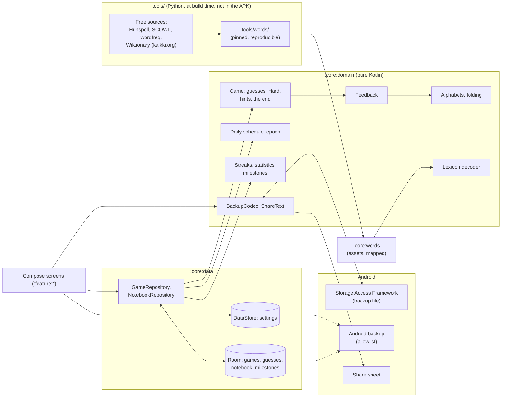

# That's The Word — Technical Planning

> Companion to [VISION.md](VISION.md). This document defines the architecture, the design of the game engine, the words and how they are made, the look of the game, and the delivery phases.
> It is written to be read by humans and by Claude Code.
>
> Keep the phase checklists up to date: tick the boxes as work is merged, and record every decision and deviation with its reason in §15's log. How the log is written and archived is in How it is made, below.

---

## How it is made (12 Nov 2026, as the family's)

- **This file** is the living plan: the architecture and the rules the code keeps (§1 to §10, §12 to §14: living, changed in place with the code, never archived), the phases still open (§11), what is open (§15, Open), and the log of the current period (§15, after Open). New decisions are written **at the end of the log**, one `###` section per intervention, with who asked and the date (and the step, where there is one).
- **`docs/planning/NN-<period>.md`** are the closed periods of the log, with the phases they closed, **frozen**: they are not edited. A decision that changes an old one is written here, naming the one it changes (the file, and the title or the entry's date).
- **`docs/planning/README.md`** is the index of every `##` and `###` heading of the archive, with its line: a reference by name or by date in the code ("PLANNING.md §11 Phase 3", "§15, 12 Nov 2026") that is not in this file is found there. It is written by `python3 tools/planning_index.py`, never by hand, and changes only when archiving. Both arrive in Phase 0, from the family; until the first archive the index is empty.
- **Archive** when the log passes ~80 KB (`sed -n '/^### Log since/,$p' PLANNING.md | wc -c`), or at a release, whichever first. A size and not a count of lines: this file writes a paragraph to a line. The log becomes the next archive file (the same header as the family's: "Frozen on <date>: a closed period of the log, moved here from `PLANNING.md` without changing a line"), and the phases of §11 that closed go with it (a closed phase's open box carried to Open); here an empty log stays with its start date, «Open» is reread, and the index script is run again (`--check` tells if the index is behind).

## State

- **Released**: nothing yet.
- **In progress**: Phase 0. The owner's vision is approved, reviewed here and answered on its first points (VISION.md, «The owner's answers», 12 Nov 2026); what is still open is in §15's Open list, to be answered before what it touches is built. The build, the design system, CI (green on GitHub) and the debug key are in place; the release key is made, rehearsed and pinned; the mark is the owner's to choose.
- **Later, and optional**: Google Play, F-Droid (§11).

---

## 1. Tech stack

The family's stack, as Tetto carries it from Tempo and Passo (Tetto ADR 0001), at the latest stable versions of 12 Nov 2026 (ADR 0001 here): a step ahead of the sisters' build, which is theirs to follow when they choose.

| Concern | Choice |
|---|---|
| Language | Kotlin 2.4, compiled by AGP 9's built-in Kotlin, with the Compose compiler Gradle plugin; KSP for Room and Hilt |
| Build | Gradle 9.9 with Kotlin DSL, AGP 9.5; version catalog (`gradle/libs.versions.toml`); convention plugins in `build-logic/` (`thatstheword.*`) |
| JDK | Java 21, `jvmTarget` 21, without a Gradle toolchain |
| SDK levels | `minSdk 34`, `targetSdk 37`, `compileSdk 37` (the family's) |
| UI | Jetpack Compose, Material 3 (1.4, stable) in the family's design language (Chiaro's generated schemes, dynamic colour on request), edge-to-edge; the game's own tiles, keyboard, motion and feedback colours (§7). Stable Material 3, as the sisters' (owner, 12 Nov 2026): Material 3 Expressive's APIs are internal in 1.4 and arrive with 1.5, still a release candidate |
| Architecture | MVVM with unidirectional data flow; coroutines and `Flow` |
| Dependency injection | Hilt |
| Persistence | Room for the games, their guesses, the notebook and the milestones (schema exported, every migration tested); DataStore (Preferences) for the settings |
| The words | Generated by a reproducible script (`tools/words/`, Python) from free sources, shipped as compact files in the APK (`:core:words`), read without copying (§6) |
| Serialization | kotlinx.serialization: the navigation routes and the backup file |
| Background | None. No service, no alarm, no worker (a daily reminder only if the owner asks for one: §8, §15 Open) |
| Navigation | Navigation 3, as the family's shell |
| Time | `java.time`, local dates for the daily word; an injected clock and zone |
| Sound and haptics | `SoundPool` with sounds generated by a script in the repository (`tools/make_sounds.py`, no third-party audio); the view's haptic constants, no `VIBRATE` (§7.5) |
| Testing | JUnit 4, Truth, Turbine, coroutines-test; Robolectric (Room, Compose UI tests); Room's `MigrationTestHelper`; Python tests for the words' script |
| Quality | Android Lint (`checkDependencies`), ktlint through Spotless; a Baseline Profile for the game screen (Phase 8) |
| CI | GitHub Actions: formatting, the forbidden-permission check on the merged manifest, unit tests and lint before the APKs. A release workflow on version tags builds the signed APK and publishes it to GitHub Releases |
| License | GPL-3.0-or-later (VISION §3). Every dependency and every data source must have a GPL-3.0-compatible licence and the owner's approval; the name and the mark are not covered (VISION §13) |

Always pick the **latest stable** versions at setup time and record them in the version catalog. Avoid alpha versions unless a phase needs them and says why.

---

## 2. Project structure

```
thats-the-word/
├── app/                    # Application, MainActivity, the shell (Navigation 3), DI entry points
├── build-logic/            # Convention plugins (android-application, library, compose, feature, hilt, room, jvm)
├── core/
│   ├── model/              # Pure Kotlin data classes (no Android deps)
│   ├── domain/             # Pure Kotlin: the game engine, the daily schedule, the words' decoder, streaks, statistics, milestones, the share text, the backup format
│   ├── words/              # The word files in assets (written by tools/words/) and their reader
│   ├── data/               # Room (games, guesses, notebook, milestones), DataStore, repositories exposing Flow
│   ├── designsystem/       # M3 theme, typography, motion, the tiles, the keyboard's keys, the feedback colours, icons, sounds and haptics
│   └── testing/            # test-only: the accessibility checks and the page walk the UI tests share
├── feature/
│   ├── home/               # Start: today's word per language, the quick language switch, the calendar (archive), free play
│   ├── game/               # The game: grid, keyboard, hints, the end card, sharing
│   ├── notebook/           # The notebook: the words met, searchable
│   ├── progress/           # Statistics, streaks, milestones
│   ├── onboarding/         # Welcome, the languages, the level (the guided first game is :feature:game's)
│   └── settings/           # Languages, level, the Hard option, sound, haptics, motion, appearance, your data, about
├── tools/                  # the words' script, the sounds' script, the launcher icon script, the planning index script
├── docs/                   # ADRs, the planning archive, the words' report, screenshots
├── keystore/               # the shared debug key (deliberately committed)
├── VISION.md
├── PLANNING.md
└── CLAUDE.md
```

Rules:

- `core:model` and `core:domain` are pure Kotlin/JVM modules. All game logic lives there and is unit-tested without Android. The words' decoder is pure too: `:core:words` only maps the files and hands their bytes over.
- Feature modules depend on `core:*`, never on each other. The guided first game is `:feature:game` in its guided mode, opened by the shell after the first run's pages.
- `app` wires everything together.
- A module joins the build in the phase that brings its first code, not before (Phase 0 has `:app`, `:core:model`, `:core:designsystem`, `:core:testing`).

---

## 3. Architecture overview



What is fixed at build time (the words, the daily schedule) never changes on the phone; what the player does (games, guesses, notebook) is in Room; what they chose (languages, options, look) is in DataStore. Nothing runs when the app is not on screen.

---

## 4. The game engine (core design)

All of it in `:core:domain`, pure, test-first, every case of §4.9 named in a test. The engine is general in the word's length and the number of attempts from the first line (1.1's modes and 1.2's lengths need it), while the data of 1.0 is five letters and six attempts (VISION §8).

### 4.1 Languages, alphabets and folding

- A **language** is `IT`, `EN` or `ES` (VISION §5), each with its **keys**: the letters the keyboard has and a guess is made of. English: A–Z. Spanish: A–Z and **Ñ**, a letter of its own with its own key (VISION §6). Italian: A–Z on the keyboard (loanwords such as *taxi* or *jeans* are words a player types), solutions only within the Italian alphabet's 21 letters (§15, Open).
- **Folding** turns a written word into its **key form**, the letters as typed: lower case, Unicode NFD, combining marks dropped, then mapped to the language's keys. In Spanish the ñ is kept before the marks are dropped (*niño* → `NIÑO`, *pingüino* → `PINGUINO`, *árbol* → `ARBOL`); in Italian and English every mark goes (*città* → `CITTA`). A word with anything left outside the keys (an apostrophe, a hyphen, a space, a digit) is not a word of the game.
- The **display form** is the word as written (*città*, *árbol*), kept with its key form in the glossary (§6) and shown at the end of a game (VISION §6, §9). Several display forms can share one key form (Italian *pero* and *però*, Spanish *esta* and *está*): the solution's display form is its own; a guessed key form shows each of its forms.
- In memory a letter is its index in the language's keys and a word an `IntArray` (or a packed `Long` where many are compared): no `Char` or `String` arithmetic in the engine, so Ñ is a letter like any other.

### 4.2 The feedback

Each letter of a guess gets one of three marks: **right place**, **elsewhere** (in the word, not here), **absent**. Duplicates are counted, in two passes:

1. Every letter in its right place is marked so and taken off the solution's count of that letter.
2. Left to right, every other letter is marked elsewhere if the solution still has an unclaimed copy of it (and that copy is claimed), absent otherwise.

So a guess with two E against a solution with one E marks one of them, the right-placed one first, else the leftmost. The keyboard shows each letter's best mark so far (right place over elsewhere over absent over unknown).

### 4.3 A game

- `GameSetup`: language, mode (`Daily(date)`, `Free(level)`, `Guided`; 1.1 and 1.2 add theirs), length, attempts (5 and 6 in 1.0), Hard on or off, the solution's key form, the interface language at the start (which decides whether hints exist: VISION §5).
- `Game`: the setup, the guesses, the hints taken, and what follows from them: the marks (computed, never stored), the attempts left (`attempts − guesses − hints`), the state (`Playing`, `Won`, `Lost`).
- `submit(guess)` answers `Accepted(marks)` or `Refused(reason)`: too short; not a word (§6's accepted set, by key form); Hard's rule not kept (§4.4), naming the first requirement missed. A refused guess costs nothing.
- Won when every letter is in its right place; lost when no attempt is left. A finished game takes nothing more.
- A game is saved after every guess and every hint (Room, §5), and taken up where it was left, on any page, after any restart.

### 4.4 The Hard option

Every clue found must be used (VISION §8): a letter found in its right place stays there; a letter found elsewhere is in every later guess, as many times as it was marked (two E marked, two E needed). A letter revealed by a hint counts as found in its right place. Hard is chosen before a game's first guess and holds for that game; the setting applies to the next game. The statistics count a game with Hard apart, and its share text says so.

### 4.5 Hints and what they cost

Only in a game whose language is not the interface's (VISION §5, §9). Three kinds, each once a game: **translation** (the solution's translation in the interface language), **definition** (a definition in the interface language), **letter** (the leftmost position not yet found, revealed in its right place: the same letter for every player of a daily). Each costs one attempt: the grid's last empty row is spent, and drawn as the hint's row, so the cost is in sight. No hint when one attempt is left: it would end the game. A word with no translation or definition offers no such hint. Games with hints count for the streak, and are marked in the statistics (VISION §9).

### 4.6 The daily word and the archive

- **The epoch** is the date of daily number 1 (§15, Open: proposed, the 1.0 release's date). The daily of a local date `d` is number `d − epoch + 1`, and its word is the language's frozen schedule at that number (§6.5): the same for every player, from the local date alone, with no server (VISION §8). It changes at local midnight.
- A daily game belongs to the **date it was started on**: one started at 23:58 and finished at 00:03 is the earlier day's, for the calendar and the streak.
- **The archive**: every date from the epoch to today, per language, marked solved, missed or not played; future dates are not playable (a phone's clock set ahead is not checked against anything, and needs not be: nobody is competing).
- **A day's result is its first finished game** (§15, Open: proposed). A day already finished can be played again as practice: not counted, not in the calendar, not in the notebook's marks.
- The schedule must outlast the app: the script writes at least ten years from the epoch, and a test fails when fewer than three years are left from the build's date.

### 4.7 Free play and the levels

- Four **levels** by frequency (VISION §9), cumulative: Base ⊂ Intermediate ⊂ Advanced ⊂ Complete (§15, Open: proposed). The level is the game language's own (an Italian player can be at Complete in Italian and at Base in Spanish); in a foreign language it starts at Base.
- **Free play** draws a solution at the level, never one of the language's last 200 free games nor one solved in free play before, until the level runs out (then the oldest come back). The daily draws from Base and Intermediate only, because it is the same for everyone (VISION §9).

### 4.8 Streaks, statistics and milestones

- **Streak**, per language: the run of consecutive dates, ending today or yesterday, whose daily was won on its own date (§4.6), hints or not. A daily won from the archive counts in the statistics and the calendar, never in the streak (VISION §11). The longest streak is kept as the statistics' answer, computed, not stored.
- **Statistics**, per language and mode: games, the share won, the distribution of guesses for the games won, the games with hints, the games with Hard. Computed from the games table by query, never kept as counters that could drift.
- **Milestones** (VISION §11): a closed list in the domain, each a predicate over the facts (the games, the notebook) and a sentence in the three languages; checked after every finished game and every notebook change, unlocked once with its date, never taken back. The first list, from the vision: seven dailies in a row; a first win in a foreign language; 100 words in the notebook; a day's daily won in all three languages. Recognition, never a key (VISION §11).

### 4.9 Edge cases (all need unit tests)

| Case | Expected |
|---|---|
| A guess with a letter twice, the solution with it once, one in its right place | That one right place, the other absent |
| A guess with a letter twice, the solution with it once, neither in place | The leftmost elsewhere, the other absent |
| The solution with a letter twice, the guess with it once, out of place | Elsewhere |
| Spanish *ñ* against *n* | Two different letters: `AÑOS` and `ANOS` differ |
| Italian *città* typed as `CITTA` | Accepted; the end card says *città* |
| A key form with two display forms | Both shown for a guess; the solution's own for the solution |
| Hard: a right-place letter moved | Refused, naming the position |
| Hard: an elsewhere letter twice, guessed once | Refused, naming the letter |
| Hard and the letter hint | The revealed letter required in its place |
| A hint with one attempt left | Not offered |
| Three hints, then three wrong guesses | Lost, six attempts used |
| A daily started 23:58, finished 00:03 | The earlier date's, for the streak and the calendar |
| A daily played at 23:59 in Rome and at 00:01 after flying to London | Each local date its own word; no game is moved |
| The daily of a date before the epoch, or after today | Not playable |
| A day finished, then replayed and won | The first result stands |
| Daylight saving's change at night | One date, one word |
| The streak with yesterday's daily won and today's not yet played | Still running |
| The streak with yesterday missed | Ended; today's win starts at 1 |
| An archive win for a missed day | Calendar solved, statistics counted, streak untouched |
| Free play at a level where every word was played | The oldest come back |
| The schedule shorter than three years from the build date | A test fails |

---

## 5. Data model

### `:core:model` (pure)

`Language`, `Letter` (an index in a language's keys), `Word` (key form), `Mark` (right place, elsewhere, absent), `Guess`, `GameMode`, `GameSetup`, `GameState`, `Level`, `HintKind`, `NotebookEntry`, `Milestone`, the settings enums and `UserSettings`, the appearance (`ThemeMode`, `AppPalette`, `AppFont`).

### Room (`ThatsTheWordDatabase`, file `thatstheword.db`, version 1, from Phase 3)

| Table | Columns | Notes |
|---|---|---|
| `games` | `id`, `language`, `mode`, `daily_date` (epoch day, for a daily), `level` (for free play), `solution` (key form), `length`, `attempts`, `hard`, `ui_language`, `status`, `started_at`, `finished_at`, `practice` | A daily's counted game unique per `(language, daily_date)` when not practice. The marks are never stored: they follow from the solution and the guesses |
| `guesses` | `game_id`, `position`, `word` (key form) | Cascade on the game's delete |
| `hints` | `game_id`, `kind`, `position` | The order they were taken in |
| `notebook` | `language`, `word` (key form), `first_met`, `last_met`, `times_met`, `solved`, `missed`, `with_hints`, `saved_by_hand` | One row per word and language; the meanings are read from `:core:words`, never copied. 1.1's review adds its columns by a tested migration |
| `milestones` | `id`, `unlocked_at` | |

Never `fallbackToDestructiveMigration`; the schema is exported to `core/data/schemas/` and committed; every migration has a test, and the upgrade from the first release's schema is tested.

### DataStore (Preferences), file `settings`

The game language; the level per language; Hard; sound, haptics, reduced motion (the system's by default); the appearance (theme, dress, typeface, wallpaper colours); the first run done; the first-day tips seen. The interface language is not here: it is the system's per-app language (`locales_config.xml`), opened from Settings.

### Backup

- **Android's backup** (`data_extraction_rules.xml`, an allowlist from Phase 0): the database and the settings file. The words ship in the APK and are never copied.
- **The backup file** (VISION §11): the games, the notebook, the milestones and the settings, as versioned JSON (`BackupCodec`, kotlinx.serialization), written and read through the Storage Access Framework. A restore is read whole and checked (not a backup, a newer version, damaged) before anything is written, says what it holds, and replaces only after the player's confirmation, as the family's.

---

## 6. The words

The words are the riskiest part of the game, and the heaviest (VISION §10, §16 questions 3 to 5): Phase 1 builds them first and measures them before anything is drawn.

### 6.1 Sources

| Data | Source | Licence | To check in Phase 1 |
|---|---|---|---|
| Italian words, every form | Hunspell `it_IT` (LibreOffice dictionaries), expanded | GPL-3.0 | The version and its affix rules |
| Spanish words, every form | Hunspell `es` (the RLA-ES project), expanded | GPL-3.0 / LGPL-3.0 / MPL-1.1, to verify | The licence of the exact release (VISION Q3) |
| English words, both spellings | SCOWL (up to size 70 for the accepted set), with its British and American variant lists; ENABLE as a public-domain fallback | SCOWL's own permissive notice; ENABLE public domain | The size that refuses no common word |
| Frequencies | `wordfreq`'s data (frozen since 2024), cross-checked with OpenSubtitles lists | CC BY-SA 4.0 | The thresholds of the four levels |
| Meanings, translations, parts of speech, written forms | Wiktionary, as extracted by wiktextract (kaikki.org): the English, Italian and Spanish editions | CC BY-SA 4.0 and GFDL | Coverage per language pair (§6.4) |

The expansion of Hunspell's affixes is done by a tool run at build time, never shipped (an `unmunch` or a pure-Python expander, its licence recorded). Every source is downloaded by the script at a pinned version with its checksum, into a cache outside the repository; what ships is only what the script writes.

### 6.2 The two sets

- **Accepted** (VISION §10): every form of the right length, inflected ones included, as wide as the sources allow: fewer unfair refusals. Folded to key forms (§4.1), duplicates merged.
- **Solutions**: base forms only (a Wiktionary lemma, not a "form of"), no proper nouns, abbreviations, offensive or vulgar words (Wiktionary's tags, and a deny list per language kept in the repository and read by a person), no word with two spellings in English, no Italian word outside its alphabet's 21 letters (§15, Open). Every solution is in the accepted set, and has a meaning (§6.4).

### 6.3 Levels

Each solution gets a frequency (Zipf, from `wordfreq`) and its level from four thresholds per language, chosen in Phase 1 so that Base reads as a learner's first thousand words and Complete takes everything left. The thresholds are written in the script with the counts they give, in the words' report.

### 6.4 Meanings and translations

What the end card, the hints and the notebook show is always in the **interface language** (VISION §5). For each of the nine pairs (game language × interface language):

- **The same language**: the word's own definition, from its language's Wiktionary edition (an Italian word in Italian from the Italian edition).
- **A foreign word**: its translation into the interface language, and a short meaning in the interface language. English glosses of Italian and Spanish words are rich (the English edition); Italian glosses of Spanish words, and Spanish ones of Italian words, are not. Where the interface's own edition has no entry, the meaning comes **through the translation**: the word's sense (from the English edition, with its translation table), its translation in the interface language, and that word's definition in its own edition.
- A word whose translation is unreliable (no sense matched, several unrelated senses) has none: the end card shows the meaning alone (VISION §9), and 1.1's Translate and Bridge never use it (VISION §10).

Phase 1 measures the coverage of each pair on the solutions, and a sample of 50 words per pair is read by a person before the owner decides (VISION Q4).

### 6.5 The daily schedule, frozen

Per language, the list of the dailies' words in order, written by the script from the Base and Intermediate solutions, shuffled with a recorded seed, at least ten years long. It is **append-only** (VISION §10): the script reads the committed file, refuses to change any entry already there, and only adds at its end. It stores the words themselves (their key forms), not indices into a list that a later source could reorder. It is not plain text, so a glance at the repository spoils nothing; a determined reader can always decode it (the code is open), which is accepted: nobody is competing.

### 6.6 What ships, and how it is read

Per language, a few files in `:core:words`'s assets, uncompressed in the APK so they can be mapped, not copied: the accepted key forms, sorted and packed (five bits a letter: a five-letter word in four bytes), found by binary search; the solutions with their levels; the daily schedule; per interface language, the glossary (display forms, meanings, translations, part of speech), in blocks with an index. The decoder is pure Kotlin in `:core:domain`, tested on the JVM against small files the tests write; `:core:words` maps the assets and hands their bytes over. The sizes are measured in Phase 1 (VISION Q5), the formats chosen then, in `docs/adr/0003-words.md`.

### 6.7 Reproducibility and credit

`tools/words/` is a Python package with its own tests: one command rebuilds every file from the pinned sources, and a second run writes the same bytes. Its report (`docs/words/README.md`) gives each source's version, licence and checksum, the counts per set and level, the coverage per pair, the sizes. Each source is credited in `licenses/README.md` and in Settings, About (VISION §10).

---

## 7. The look and feel of the game

### 7.1 The family's language, and where a game departs

The family's design system, copied (ADR 0002): the generated dresses (Paper and Vivid), Google Sans, Inter or the phone's sans, the shapes, the springs, the page gutter, the accessibility checks; one sentence before a number; every number with the line that says what it means; no dead control. A game departs where it must (VISION §12): capitals with wide tracking for the name and the short lines above a title (`wordmark`, `eyebrow`), tiles, a keyboard, livelier springs for the game's moments (`ThatsTheWordMotion.playful`), sound, and colours of its own for the feedback that never follow the dress or the wallpaper.

### 7.2 The feedback: colour and shape together (the owner's direction, 12 Nov 2026)

The marks are said by colour **and** shape (VISION §6), never colour alone, and the palette is the game's own (VISION §13):

| Mark | Colour | Shape | Letter |
|---|---|---|---|
| Right place | the app's colour (provisional: berry, as the mark's ground) | the tile stays square (corner 22%) | white |
| Elsewhere | the family's amber | the tile becomes round (corner 50%): "somewhere in the word" | dark ink |
| Absent | the dress's quietest ground, no border | the tile sinks (lower, smaller by 4%) | the quiet ink |

Square for *here*, round for *somewhere else*: the shape alone says it, in grey, under every colour blindness, and in the share text (§7.6). The two colours are a blue-red and an amber, apart under deuteranopia and protanopia, and apart from the genre's well-known green, yellow and grey. Each letter ink is pinned at 4.5:1 on its ground by `ContrastTest`. Drawn on a board in Phase 3, with two alternatives, before the owner chooses.

### 7.3 The grid and the keyboard

- The grid: the word's length across, the attempts down, the tiles as large as the column allows (56 dp on a phone, never under 44), centred; a hint's row drawn with the hint's icon where the spent attempt was.
- The keyboard: QWERTY in the three languages, with Ñ beside L in Spanish; Enter and Delete on the bottom row; every key at least 48 dp tall and a full row's share wide; each key in its letter's best mark, by colour and a small mark of its shape. A hardware keyboard types too. The phone's own keyboard is never used: the game's keys are its surface.
- Refusals are said in one line above the keyboard ("Not in the list", "The second letter must be A"), never a toast, and the row shakes.

### 7.4 Motion (VISION §12)

Every moment has its movement, every movement collapses to a fade under reduced motion (the system's setting, or the in-app switch), and no animation gates information.

| Moment | Movement |
|---|---|
| A letter typed | the tile pops (1.08 and back) with the game's spring |
| A row revealed | tile by tile, 70 ms apart, the mark's colour fills from the tile's centre while its corner moves to its shape; never the genre's flip |
| A word refused | the row shakes sideways on a spring, the line above the keyboard says why |
| A word found | the row's tiles lift one by one in a wave and settle, and the line the name stands for arrives: «That's the word.», «Ecco la parola.», «Esa es la palabra.» (VISION §2), in the interface's language; the end card rises |
| A milestone | its sentence arrives on the end card with a soft light across it, once |
| The start page | the sample word's tiles arrive one by one (Phase 0) |

### 7.5 Haptics and sound

- **Haptics** through the view's constants (`KEYBOARD_TAP` on a key, `SEGMENT_TICK` per revealed tile, `REJECT` on a refusal, `CONFIRM` on a win), so the phone's own touch-feedback setting is followed and no `VIBRATE` is needed; the in-app switch (VISION §12) turns them all off.
- **Sound**: a few short sounds written by `tools/make_sounds.py` from code (no third-party audio, no licence to carry): a key, a revealed tile (a step of a scale per mark), a refusal, a win, a milestone. Played by `SoundPool` while the game page is visible, released when it is not; silent when the phone is on silent or vibrate; the in-app switch turns them off (§15, Open: the default).

### 7.6 Sharing a result (VISION §11)

Without the word, in the app's own format: a **text** for any messaging app ("That's The Word · #123 · Italian · 4/6", Hard and hints said), with a row of symbols per guess that keep the shapes (proposal: 🟪 right place, 🟠 elsewhere, ▫️ absent; never the genre's coloured squares), and an **image** card (the grid's shapes and colours, the date, the language, no letter), shared through a `FileProvider`, which needs no permission.

### 7.7 Accessibility (VISION §12)

TalkBack reads a row as one sentence ("Row 2: C, elsewhere; A, right place; …"), a key with its letter and mark, the reveal's result once it ends (a polite live region), and every refusal. Text at twice its size: the pages scroll, the tiles keep their drawing (their letters are sized by the tile). An open foldable shows a centred column. Every screen's tests run `assertAccessible()` and `walkPage()` (`:core:testing`).

---

## 8. Notifications and system surfaces

- **None in 1.0** as the vision stands. Two proposals are in §15's Open list: a **daily reminder** (one quiet notification at the player's hour, only if today's daily is not played, gone at midnight: one inexact alarm, the family's evening reminder), and a **home-screen card** (today's word per language, solved or waiting, and the streak, on the family's card). Neither is built without the owner's answer.
- **Launcher shortcuts** (static, no permission): "Today's word" per game language, opening the daily directly (Phase 4).
- **Predictive back** everywhere (`enableOnBackInvokedCallback`), edge to edge.

---

## 9. Battery rules (non-negotiable)

1. No service of any kind, no polling, no wakelocks, no periodic work, no exact alarms.
2. Nothing runs while the app is not on screen. The change of day is noticed by a ticker in a visible page's lifecycle (the start page, the calendar), never by an alarm.
3. Sounds are loaded while the game page is visible and released when it is not.
4. The words are mapped from the APK, never copied or decompressed into storage at the first launch.
5. If the reminder is approved (§8): one inexact alarm a day, only while it is on and allowed, as the family's.

---

## 10. Permissions and manifest

| Permission / element | Type | Why |
|---|---|---|
| (none of the game's own) | | |
| `POST_NOTIFICATIONS`, `RECEIVE_BOOT_COMPLETED` | Runtime / normal | Only if the daily reminder is approved (§8) |
| `android:allowBackup="true"` + `dataExtractionRules` | Manifest | The database and the settings file only (§5) |
| `android:appCategory="game"` | Manifest | The system's game features (game mode, the launcher's grouping) |

**Forbidden:** `INTERNET`, `ACCESS_*LOCATION`, `REQUEST_IGNORE_BATTERY_OPTIMIZATIONS`, `SCHEDULE_EXACT_ALARM`, `USE_EXACT_ALARM`, `com.google.android.gms.permission.AD_ID`, `ACCESS_ADSERVICES_*`, `CAMERA`, `RECORD_AUDIO`, `READ_SMS`, `RECEIVE_SMS`, `SEND_SMS`, `READ_CONTACTS`, `WRITE_CONTACTS`, `GET_ACCOUNTS`, `READ_CALENDAR`, `WRITE_CALENDAR`, `READ_PHONE_STATE`, `READ_EXTERNAL_STORAGE`, `WRITE_EXTERNAL_STORAGE`, `MANAGE_EXTERNAL_STORAGE`, `READ_MEDIA_*`, `QUERY_ALL_PACKAGES`, `ACTIVITY_RECOGNITION`, `HIGH_SAMPLING_RATE_SENSORS`, `BODY_SENSORS*`.

The backup file goes through the Storage Access Framework (`ACTION_CREATE_DOCUMENT`, `ACTION_OPEN_DOCUMENT`), which needs no storage permission; sharing goes through the share sheet and a `FileProvider`; haptics through the view's constants, which need no `VIBRATE`.

`checkForbiddenPermissions` (build-logic, `ForbiddenPermissionPatterns`) checks every variant's merged manifest, is wired to `check`, and runs in CI and in the release workflow. A library that adds one is removed or patched with `tools:node="remove"`.

---

## 11. Delivery phases

Each phase ends with a merged PR, green CI and its acceptance criteria met. Phases 3 to 7 need **a look on a physical device**: the motion at the phone's refresh rate, the haptics, the sounds, TalkBack, a backup restored on a clean install.

**How to run a step** (the family's): one step is one session. Read CLAUDE.md, the step and the files it names; build it with its tests (the domain's first, for anything that decides a mark, a word, a date or a streak); run `spotlessApply`, `test`, `:app:lintDebug` and `:app:checkForbiddenPermissions`; look at the screenshots the step changes (`build/screenshots`); tick the step, record its decisions in §15, and add its line to `CHANGELOG.md`'s Unreleased section in the player's words. A step that changes a decision already recorded says so, and the owner confirms it before anything is built.

### Phase 0 — Foundations

- [x] Create the repo; the owner's vision committed as `VISION.md` (`cac9c5c`, 12 Nov 2026)
- [x] The vision reviewed: its questions and this review's in §15's Open list (12 Nov 2026)
- [x] `PLANNING.md`, `CLAUDE.md`, `README.md` in the family's style (centred header, badges, sections, no em or en dashes), `LICENSE` (GPL-3.0 full text), `.gitignore`, `.editorconfig`, `CHANGELOG.md` (Keep a Changelog, an empty `[Unreleased]`) (12 Nov 2026)
- [x] The owner's answers to the review's first five questions; VISION.md in English, the owner's latest version (*That's The Word*), with «The owner's answers» (12 Nov 2026); the other questions stay in §15's Open list, for the phases they touch
- [x] Gradle setup from Tetto's (Tempo's and Passo's build): the version catalog at the latest stable versions (Gradle 9.9.1, AGP 9.5.1, Kotlin 2.4.21), `build-logic` convention plugins renamed `thatstheword.*`, with the Room convention; the wrapper; `gradle/google-maven-mirror.init.gradle.kts`; `thatstheword.versionName` in `gradle.properties`, `versionCode` derived (major * 10000 + minor * 100 + patch)
- [x] The forbidden list of §10 in `ForbiddenPermissions.kt`, wired to `check`
- [x] Module skeleton: `:app`, `:core:model`, `:core:designsystem`, `:core:testing`; the others join with their first code
- [x] `:core:designsystem` from the family's: Chiaro's two generated dresses (`Scheme.kt`, never hand-edited), `Type.kt` (with the game's `wordmark`, `eyebrow`, `tileLetter`, `heroNumber`), `Shape.kt`, `Motion.kt` (with the game's `playful` spring), `PageWidth.kt`; the letter tile before its feedback (`LetterTile`); Google Sans and Inter with their licences; `TypographyTest`, `ContrastTest`, `PageWidthTest`
- [x] `:core:testing` from the family's (`assertAccessible()`, `walkPage()`)
- [x] Hilt, `MainActivity` edge to edge with the start page: the name, the subtitle, a word composed tile by tile, then the victory line (VISION §2)
- [x] `strings.xml` for `values/` (English), `values-it/` and `values-es/`; `locales_config.xml` for the per-app language
- [x] A provisional launcher mark drawn by `tools/draw_launcher_icon.py` in the family's series (a white speech bubble holding a word of three tiles, the last in amber, on berry), with its monochrome layer
- [ ] The mark and the app's colour chosen by the owner (§15, Open), drawn again by the script
- [x] The crash page (`app/src/crashpage`), for debug builds and the debug-signed release, in the three languages
- [x] CI: `android-ci.yml` (formatting, forbidden permissions, unit tests, lint, then the APKs and the R8 mapping) and the tag-triggered `release.yml` (the tag matches `thatstheword.versionName`; the same gates; the keystore decoded from the secrets; the signed APK; the signature checked against the release key's fingerprint, refusing to publish until it is pinned; the SHA-256 file; the mapping; the body from `CHANGELOG.md`)
- [x] CI green on GitHub (`b8df08e`, run 1, 5 min 30 s, 12 Nov 2026)
- [x] The game's own debug keystore (`keystore/debug.keystore`, alias `thatstheword-debug`, passwords `android`, RSA 2048, PKCS12), committed on purpose, with `keystore/README.md`; not a copy of a sister's
- [x] The **release key**: made by the owner, kept outside the repo, in the four repository secrets `KEYSTORE_BASE64`, `KEYSTORE_PASSWORD`, `KEY_ALIAS`, `KEY_PASSWORD` (12 Nov 2026)
- [x] Its SHA-256 fingerprint, confirmed by the owner, into `keystore/README.md`, the README's Install section and `release.yml`; the release rehearsed (12 Nov 2026)
- [x] `docs/planning/README.md` and `tools/planning_index.py` from the family's (How it is made)
- [x] `docs/adr/0001-foundations.md`, `docs/adr/0002-design-language.md`

**Acceptance:**
- CI is green on GitHub.
- The app launches and shows the start page in the family's dress, in English, Italian and Spanish.
- Adding `INTERNET` or `CAMERA` to any manifest fails `checkForbiddenPermissions` (checked on 12 Nov 2026, §15).

### Phase 1 — The words (highest risk, a gate)

- [ ] `tools/words/`: the pipeline in Python, its sources pinned with their checksums and fetched into a cache outside the repository, its own tests, one command to rebuild everything, the same bytes on a second run
- [ ] The licences of the exact releases checked and recorded (VISION Q3), each source in `licenses/README.md`
- [ ] The accepted sets per language at five letters, with their counts; a list of 200 common words per language that must all be accepted
- [ ] The solutions per language: lemmas, no proper nouns, abbreviations, offensive or vulgar words (Wiktionary's tags, the deny lists read by a person), the English double spellings and the Italian foreign letters out; the four levels' thresholds and counts
- [ ] Meanings and translations: the coverage of the nine pairs on the solutions (§6.4); a sample of 50 words per pair read by a person; **the owner's go** on their quality (VISION Q4)
- [ ] The daily schedules, ten years per language, append-only, not plain text, with the test of §4.6
- [ ] The files' formats and their sizes in the APK measured (VISION Q5); `docs/adr/0003-words.md`
- [ ] The report: `docs/words/README.md`

**Acceptance:**
- [ ] The report answers VISION's questions 3, 4 and 5 with numbers, and the owner has said go.
- [ ] A second run of the script writes the same bytes.

### Phase 2 — The game engine

- [ ] `core:model`: §5's classes
- [ ] `core:domain`, test first, every case of §4.9: alphabets and folding, the feedback, `Game` (submit, refusals, Hard, hints, the end), the daily's number and word, free play's draw, streaks, statistics, milestones' predicates, the share text
- [ ] The words' decoder (pure) and `:core:words` (the assets, mapped); a word found among 30,000 in under a millisecond on a mid-range phone

**Acceptance:**
- [ ] Every §4.9 case named in a test, green.

### Phase 3 — The game screen

- [ ] The feedback's colours and shapes drawn on a board (two or three proposals, light and dark, under the three colour blindnesses and in grey), **chosen by the owner**, then `ContrastTest`'s pairs
- [ ] `:core:data`: `ThatsTheWordDatabase` version 1 (§5), the schema exported; `GameRepository` (a game saved after every guess and hint, taken up where it was); `SettingsRepository`
- [ ] The shell (Navigation 3); `:feature:game`: the grid, the keyboard with its marks, the refusals' line, the end card (the solution and its display form, the guesses, share), the hardware keyboard
- [ ] The motion of §7.4, the haptics of §7.5; the reduced motion's fades
- [ ] The daily in the game language from a provisional start page
- [ ] UI tests from states, with `assertAccessible()` and `walkPage()` at twice the text size and on an open foldable; TalkBack's sentences; the screenshots looked at

**Acceptance:**
- [ ] A daily played from start to end, closed in the middle and taken up again.
- [ ] TalkBack reads a revealed row as one sentence; at twice the text size nothing is cut.
- [ ] The reveal holds the phone's refresh rate on a mid-range device (looked at with the profiler).

### Phase 4 — Start, the daily, the archive and free play

- [ ] `:feature:home`: today's word per language (waiting, in progress, solved in n, missed), the quick switch of the game language, the streak, the calendar of the dailies (solved, missed, not played) with the archive's games, free play with its level
- [ ] The Hard option (§4.4), from the start page and the settings
- [ ] Practice replays (§4.6); the launcher's static shortcuts
- [ ] The live change of day while the start page is on screen

**Acceptance:**
- [ ] The calendar of a month with solved, missed, unplayed and archive days reads right in the three languages.

### Phase 5 — Practising a language: hints, meanings, the notebook

- [ ] The hints (§4.5) with their cost drawn
- [ ] The end card's meanings: for the solution and each guess, the meaning, the translation in the interface language, the written form with its accents (VISION §9)
- [ ] `:feature:notebook`: the words met (§15, Open: which), with translation, language and date, solved, missed or with hints, searchable as a small dictionary
- [ ] Milestones' first list (§4.8)

### Phase 6 — Progress and your data

- [ ] `:feature:progress`: statistics per language and mode, the distribution, hints and Hard counted apart, the streaks, the milestones
- [ ] The backup file: `BackupCodec` with its tests (damaged, newer, not a backup, the round trip), export and restore with the confirmation
- [ ] Android's backup checked with `bmgr` on a device
- [ ] Sharing: the text and the image card (§7.6)

### Phase 7 — First run, settings and sound

- [ ] `:feature:onboarding` in the family's frame (no icon): welcome; the game language (the phone's, or another); the level for a foreign language; then **the guided first game** (`:feature:game`'s guided mode: a fixed easy word, each rule said the first time it happens, never a page of instructions: VISION §12)
- [ ] `:feature:settings`: the languages (the interface's through the system's per-app picker), the level, Hard, sound, haptics, motion, appearance (theme, dress, typeface, wallpaper colours, as the family's), your data, about (the privacy statement, "That's The Word sends nothing", the licences and every source's attribution)
- [ ] `tools/make_sounds.py` and the sounds of §7.5

### Phase 8 — Accessibility, polish and the README's pictures

- [ ] The accessibility pass: contrast, labels, targets, twice the text size, foldables, the whole game with TalkBack
- [ ] The Baseline Profile for the start and the game; start-up measured
- [ ] README screenshots (`ReadmeScreenshots`, sample games, English) and their table in the README
- [ ] The Spanish and Italian texts read by a native speaker (§15, Open)

### Phase 9 — Release on GitHub (v1.0.0)

- [ ] The name checked in the stores and the trademark registers (VISION Q1)
- [ ] The epoch fixed (§4.6) and the schedules checked against it
- [ ] `CHANGELOG.md`'s 1.0.0 section; `thatstheword.versionName=1.0.0`; tag `v1.0.0`
- [ ] The README's download link and the release key's fingerprint
- [ ] The sister apps' READMEs name the game in "The family"
- [ ] The log archived, as How it is made says

### Version 1.1 — the language modes (VISION §8; planned after 1.0)

Translate, Bridge and Review. Bridge needs words of several lengths in the three languages (*gatto / cat / gato*), before 1.2's variable length: the accepted sets of every length it uses come with 1.1 (§15, Open).

### Version 1.2 and later — the variants (VISION §8)

The ladder, several grids, variable length, the lying row: their attempts tuned by playing prototypes.

### Google Play and F-Droid (optional, later)

As the family's: the same key, the store listing, the data safety form ("no data collected, no data shared"). F-Droid builds from source: the words' files are committed outputs of the script, and the script is in the repository.

---

## 12. Testing strategy

- **Pure Kotlin first.** The folding, the feedback, `Game`, Hard, hints, the daily's number and word, free play's draw, streaks, statistics, milestones, the share text, the words' decoder and `BackupCodec` are tested on the JVM with fixed dates, zones and words, every §4.9 case named in a test.
- **The words' script** has its own Python tests (folding, the expansion, the filters, the append-only schedule), and a second run must write the same bytes.
- **Room under Robolectric.** The repositories on an in-memory database: a game saved and taken up, the unique daily, the cascade. Every migration with `MigrationTestHelper`, and an upgrade test from the first release's schema.
- **Screens from states.** Compose UI tests draw a screen from a state, never from a database, with `assertAccessible()` and `walkPage()` (`:core:testing`), at twice the text size and on an open foldable, in the three languages where words differ in length; their screenshots land in each module's `build/screenshots` and are looked at.
- **On a device**, for what only a device can say: the motion at the phone's refresh rate, the haptics, the sounds and silent mode, TalkBack through a whole game, a backup restored on a clean install.

---

## 13. Working with Claude Code

`CLAUDE.md` holds the operating rules (commands, modules, invariants, design, signing). The workflow, as in the family:

- Work one phase at a time, from its section in §11.
- Write the domain test first for anything that decides a mark, a word, a date or a streak.
- Tick the boxes as work lands; record every decision and deviation, with its reason, in §15, as a `###` section at the end of its log (and as an ADR in `docs/adr/` when it is architectural). The closed periods of the log are archived, frozen, in `docs/planning/` (How it is made, at the top).
- Run `spotlessApply`, `test`, `:app:lintDebug` and `:app:checkForbiddenPermissions` before pushing.

---

## 14. Risks and mitigations

| Risk | Mitigation |
|---|---|
| Meanings and translations too thin in some language pairs | Phase 1 first, a gate: coverage measured per pair, a person reads samples, the owner decides; the meaning through the translation (§6.4); no translation shown when it is unreliable |
| A source's licence unfit to ship | Checked on the exact release in Phase 1; alternatives named (§6.1) |
| An offensive or obscure word as a daily | Lemmas only, Wiktionary's tags, deny lists read by a person, the daily from Base and Intermediate only |
| A daily that changes after release | The schedule append-only, the script refuses to rewrite it, a test |
| Spoilers in a public repository | The schedule not in plain text; accepted beyond that |
| The genre's trademark and look (VISION §13) | Its name never written outside VISION §13; the game's own palette, shapes, reveal and share symbols (§7) |
| The APK too large | Five letters only in 1.0; packed files, measured in Phase 1 |
| A game lost to a crash or a restart | Saved after every guess and hint |
| Jank in the reveal | Springs on the GPU's layer, no allocation per frame; the Baseline Profile; looked at on a device |
| Spanish or Italian that reads translated | A native speaker's read before 1.0 (§15, Open); VISION §2's rule: the same rhythm, not the same words |
| An unfair refusal of a real word | The accepted set as wide as the sources allow; 200 common words per language that must pass |

---

## 15. Decisions log and open questions

### Open

What is still to decide or to do, in one place, besides the steps of the phases in §11 (which keep their boxes there): a box opens here, with the reference to the log entry it comes from, and closes here, with the one that closes it. A new question is written here and asked before it is built. The owner answered 1, 2, 3 and 5 on 12 Nov 2026; 4 is open, and 6 to 17 are needed by the phases they name.

From this review (§15, 12 Nov 2026, «The repository, the vision's review and this plan»), each with a proposal:

- [x] **1. The name, the repository, the package.** Closed by the owner's answer (§15, 12 Nov 2026, «The owner's answers»): *That's The Word*, the owner's latest vision; the repository `thats-the-word`, as VISION §2 names it; the package `com.callbackdev.thatstheword`.
- [x] **2. The documents' language.** English, as the family's (the same entry): VISION.md translated, the owner's Italian original in the history (`0d7cacf`).
- [x] **3. Material 3 Expressive.** Stable Material 3, as the sisters' (the same entry): 1.4 now, with the game's own springs and shapes (§7.4).
- [ ] **4. The app's colour and its mark.** Provisional: berry (`D86BBE · AE3790 · 7E1D68`, away from the sisters' green, coral and indigo) and a speech bubble holding a word, its last tile amber. Drawn and looked at (12 Nov 2026), it reads like a messaging app's "typing" bubble: a placeholder, no more. The owner's first idea (12 Nov 2026): letter blocks that compose a word. To do: three symbols drawn on a board with the family's marks, as on 9 Nov 2026, the owner's idea among them, at the launcher's sizes and in the themed icon's one ink; the owner chooses, then the app's colour follows.
- [x] **5. The feedback's colours and shapes** (§7.2). The proposal accepted, with the owner's condition that every solution be a premium app's (the same entry): drawn on a board in Phase 3, with its motion, before it is built.
- [ ] **6. Italian's keyboard and its foreign letters.** Proposed: the keyboard has all 26 letters (*taxi*, *jeans*, *yacht* are words a player types); the solutions keep to the Italian alphabet's 21.
- [ ] **7. Bridge needs several lengths before 1.2.** VISION puts Bridge in 1.1 and variable length in 1.2 because each length costs its lists, but *gatto / cat / gato* already has three lengths. Proposed: the accepted sets of every length come with 1.1 (they are cheap: filtered expansions); what 1.2 adds per length is the solutions, their levels and meanings. And Bridge plays the player's chosen languages, two or three, not always all three: a learner of one foreign language should not need the third.
- [ ] **8. What the notebook gathers.** "The words met" could mean every guess: six a game, mostly words the player knows. Proposed: the solutions by themselves; a guessed word by a touch on the end card ("Add to the notebook").
- [ ] **9. A day played twice.** Proposed: a day's result is its first finished game; a finished day can be played again as practice, not counted (§4.6); a daily belongs to the date it was started on.
- [ ] **10. The epoch** (daily number 1). Proposed: the day 1.0 is released; until then a provisional epoch for development, fixed in Phase 9.
- [ ] **11. Hints' details** (§4.5): each kind once a game; the cost drawn as the last row spent; none with one attempt left; the letter is the leftmost not yet found, the same for every player. Proposed as written.
- [ ] **12. The levels are cumulative** (Base inside Intermediate, …, Complete everything) and each game language has its own. Proposed as written (§4.7).
- [ ] **13. Sound and haptics' defaults.** Proposed: both on; sound silent whenever the phone is on silent or vibrate; haptics following the phone's own touch-feedback setting; the in-app switches of VISION §12 turn each off.
- [ ] **14. Settings, two additions.** Proposed: Appearance as the family's (theme, dress, typeface, wallpaper colours; VISION speaks of light and dark only), and the interface language through Android's per-app picker, which Settings opens (the family's way), rather than a list of the app's own.
- [ ] **15. A daily reminder and a home-screen card**, not in VISION. Every sister has its cards, and a daily game is the kind of app a quiet reminder serves. Proposed: the reminder in 1.0 (one inexact alarm, silent on a day already played: the family's code), the card in 1.1; or neither.
- [ ] **16. A native speaker's read** of the Spanish and Italian texts before 1.0 (VISION §2: the same rhythm, not a translation). Who?
- [ ] **17. A rules reference.** VISION wants the rules learned by playing, no instructions page; the family has a guide first in Settings. Proposed: the guided first game only, and in Settings a short "How to play" card (three lines and a sample row) for whoever comes back after a while; no guide.

From VISION §16, still open:

- [ ] **VISION Q1: the name's availability** in the stores and the trademark registers, by hand, before 1.0 (Phase 9); a close name exists, «What's The Word» (VISION §16). Also to look at then: how the launchers show a fifteen-character name under the icon (some cut it to «That's The W…»).
- [ ] **VISION Q2: the modes' names** in the three interface languages (with the strings of each phase).
- [ ] **VISION Q3: the licences** of the Spanish and English sources and of Wiktionary's data (Phase 1).
- [ ] **VISION Q4: the definitions' quality** in the three interface languages (Phase 1, its gate).
- [ ] **VISION Q5: the app's size** with three languages' words and meanings (Phase 1).

From Phase 0:

- [x] **The release key's fingerprint** (§11 Phase 0): pinned (§15, 12 Nov 2026, «The release key's fingerprint pinned»).
- [x] **The environment's setup script**: `build-tools;36.0.0` added to its `sdkmanager` line, for every repository of the family (§15, 12 Nov 2026, «The owner's answers»).

---

### Log since 12 Nov 2026

### 12 Nov 2026 — The repository, the vision's review and this plan (owner)

The owner created `fiorenzobrioni/thats-the-word` with the approved vision of a new game, *On My Tongue*, as `VISION.md` (in Italian, `cac9c5c`), and asked for: a careful reading and an assessment of the idea and of every point; the doubts and inconsistencies raised before they are built, with proposals; the repository's structure; this plan, with the family's archive rules; a README in the family's style; the proposed stack at the latest stable versions; and graphics, motion, type and UX of a premium Android app, coherent with the family (Chiaro, Passo, Tempo, Tetto, Saldo) and departing from it only where a game must. Done:

- **The assessment.** The idea stands: a daily word game whose own ground is the foreign language (a game in a language not the interface's, with its tools, meanings in the player's own language and a notebook), offline, open, without ads or accounts, in three languages. It fits the family: one thing, done very well, private by construction. Its risk is not the game, a few hundred lines of well-known logic, but **the words**: three languages' lists, levels, meanings and translations in nine pairs, from free sources, reproducibly. So the plan puts the words first, as a gate (Phase 1), before any screen, as the sisters put their engines first.
- **What the vision leaves to decide**, with a proposal for each, is §15's Open list, 1 to 17, besides the vision's own five questions. The ones that touch the scaffold are the name and the package (1, used as proposed), the documents' language (2) and Material 3 Expressive (3).
- **One inconsistency** in the vision: Bridge (1.1) needs words of several lengths, which the vision costs to 1.2 (Open 7).
- **The genre's trademark** (VISION §13) is honoured in the documents and the code: its name is written nowhere but in VISION §13 and its reference; CLAUDE.md makes it a rule, and §7 gives the game a look of its own (the shapes, the colours, the reveal, the share text).
- **The plan**: the family's sections, with the game engine (§4), the words (§6) and the look of the game (§7) where the sisters have their engines and widgets; ten phases to 1.0, then 1.1 and 1.2 as the vision orders them.
- **The repository** is `fiorenzobrioni/thats-the-word` for now; the package and applicationId `com.callbackdev.onmytongue` (debug `.debug`), pending Open 1. Licence GPL-3.0-or-later (VISION §3), the name and the mark outside it.

### 12 Nov 2026 — Phase 0: the foundations (owner, the same request: "Prepara la struttura generale del repo")

The family's build, from Tetto's (itself Tempo's and Passo's), with the game's names:

- **The versions**: the latest stable of 12 Nov 2026, as the owner asked ("se pensi sia meglio usare Gradle e altri tool in versione stabile più recente fallo"): Gradle 9.9.1, AGP 9.5.1, Kotlin 2.4.21, KSP 2.3.13, kotlinx.serialization 1.13.0, Spotless 8.11.0, DataStore 1.3.0, Navigation 3 1.2.1; the Compose BOM 2026.09.00 (material3 1.4.0), Room 2.8.5, Hilt 2.60.1, Robolectric 4.17 as the sisters'. The sisters stay on Gradle 9.8 and AGP 9.4.1 until they choose to move (ADR 0001). The SDK is unchanged (compile and target 37, build-tools 37.0.0 in the environment); AGP 9.5 builds with build-tools 36.0.0 and downloaded them by itself (Open, the setup script).
- **The modules**: `:app`, `:core:model` (the appearance's enums), `:core:designsystem` (the family's theme, with the game's type roles, its `playful` spring and the letter tile before its feedback), `:core:testing`. The others join with their first code (§2).
- **The start page**: VISION §2's reference texts in the three languages, the capitals drawn (the strings in sentence case, TalkBack reading words), a five-letter word of each language on tiles that arrive one by one on the game's spring (*Table*, *Sedia*, *Silla*: the same rhythm, not a translation), a fade under reduced motion.
- **The forbidden list** is the family's, with what a game must never hold besides: the advertising id (Google's and the platform's ad services), accounts, the phone's state, sending SMS (§10).
- **Signing**: the game's own debug key (`onmytongue-debug`, SHA-256 in `keystore/README.md`); the release workflow refuses to publish until the release key's fingerprint is pinned (Open).
- **The mark** is provisional (Open 4): the family's series of 9 Nov 2026, a white speech bubble holding a word of three tiles, the last in amber, on berry, inside the 28-unit keyline (27.3).
- **Checked** in the cloud environment: `spotlessCheck`, `checkForbiddenPermissions`, `test` (15 tests: the start page in the three languages, dark, the paper dress, a small phone, twice the text size, an open foldable; contrast, typography, the page's gutter), `:app:lintDebug`, the debug APK and the minified release signed with the debug key (2.0 MB, 1.2 of them the fonts); `INTERNET` added to the app's manifest fails both variants' permission checks, then removed. The start page's screenshots looked at. On GitHub, CI's first run is green (`b8df08e`, 5 min 30 s).

### 12 Nov 2026 — The owner's answers: the name, English, Material 3, the feedback; the setup script; the release key (owner: "punto 2 segui la famiglia e fai tutto in inglese; punto 3 usiamo Material 3 stabile come le app gemelle; punto 4 per l'icona vediamo; punto 5 va bene la tua proposta. L'importante è che mi proponi soluzioni da premium app"; "Sì, applica tu la modifica allo script d'ambiente")

The owner answered the review's first five questions, and sent their latest vision: the one first committed was an earlier draft. What changes, each closing its box in Open:

- **The name is *That's The Word*** (Open 1), the owner's latest vision (`0d7cacf`): what one says when the word on the tip of the tongue finally comes, and the line the game greets every win with (*Ecco la parola.*, *Esa es la palabra.*); the subtitle «One word a day. Three languages.»; the repository `thats-the-word`, named by the vision itself. The two versions differ only in §1, §2 (the name, its meaning, the victory line, the repository, the subtitle; the earlier reference texts of the start page are gone) and §16's first question (a close name, «What's The Word»): the rest was compared line by line and is the same. This changes the entries «The repository, the vision's review and this plan» and «Phase 0» above: **the scaffold is renamed** (the package and applicationId `com.callbackdev.thatstheword`, the convention plugins `thatstheword.*`, the property `thatstheword.versionName`, the release properties `THATSTHEWORD_*`, the Kotlin types `ThatsTheWord*`, the database `thatstheword.db`, the APKs `thats-the-word-vX.Y.Z.apk`), and **the debug key is made again** under the new name (`thatstheword-debug`, `CN=That's The Word Debug`, SHA-256 in `keystore/README.md`): the first was hours old and never installed anywhere, and a key named after another app would have stayed in every debug build.
- **The start page** follows the vision: the name, the subtitle, a word composed tile by tile (*Table*, *Sedia*, *Silla*), then, once the last tile has landed, the victory line in the interface's language; under reduced motion each piece fades in at the moment it would have arrived. The name is drawn with the typographic apostrophe (*That’s The Word*), in the launcher's label too.
- **English** (Open 2): VISION.md translated faithfully, section for section, so every «VISION §N» of the plan still points where it did; the modes' English names are working names (VISION Q2); «The owner's answers» added. Its §14 says the stack is stable Material 3.
- **Material 3, stable** (Open 3), as the sisters'; §1 says so.
- **The feedback** (Open 5): the proposal of §7.2 is the direction; the owner's condition, premium solutions, is §11 Phase 3's first box.
- **The mark** (Open 4) stays open; the owner's first idea, letter blocks that compose a word, goes on the board with two others.
- **The setup script** of the cloud environment «Android 37», which the four repositories share: `build-tools;36.0.0` added to its `sdkmanager` line, run whole in this session first (exit 0). AGP 9.4.1 (the sisters') and 9.5.1 (this repository) both build with build-tools 36.0.0 (read from AGP's own `ToolsRevisionUtils`), so every repository stops downloading them at its first build; nothing is removed, 37.0.0 stays. It takes effect when a container is next built fresh.
- **The release key**: the owner made it and set the four secrets with `gh secret set` (12 Nov 2026). Their values cannot be read from here, by design; what proves them is a signed build. `release.yml` now prints the certificate the APK was signed with before it checks the pinned fingerprint, so a rehearsal shows which key the secrets hold, and still refuses to publish while none is pinned.

### 12 Nov 2026 — The release key rehearsed (owner: "ho creato la chiave per l'apk come per gli altri repo gemelli e copiato i secrets con i comandi gh [...] Verifica")

The release workflow can only be started by hand from the default branch, which holds the vision alone; so it was rehearsed once on this branch, by a push trigger added for one commit (`9f3bd5f`) and removed by the next (`dbcdbe3`). The publishing steps run on tags only, so nothing was published. Release run 1: the four secrets present and decoded, the minified APK built and signed with them (so the store password, the alias and the key password are right), then the signature's check stopped, by design, on the fingerprint not yet pinned, after printing the certificate: `CN=callbackdev`, SHA-256 `14:D4:1B:20:DC:B0:B1:FC:DB:22:42:DE:0B:0C:3D:09:B5:55:07:7E:D5:4D:9B:34:13:F0:00:07:A3:D1:BE:4B`. It is none of the sisters' published keys (Passo's, Tempo's, Tetto's), so the secrets hold a key of the game's own. It is pinned in `release.yml`, `keystore/README.md` and the README once the owner has compared it with `keytool -list -v` on the key itself (Open).

### 12 Nov 2026 — The release key's fingerprint pinned (owner: "L'impronta coincide, fissala pure (è una chiave nuova creata apposta per questa app)")

The owner compared the rehearsal's certificate with `keytool -list -v` on the key itself: the same. A key made for this app alone, as the sisters each have theirs. Its SHA-256,

`14:D4:1B:20:DC:B0:B1:FC:DB:22:42:DE:0B:0C:3D:09:B5:55:07:7E:D5:4D:9B:34:13:F0:00:07:A3:D1:BE:4B`

is pinned in `release.yml` (`RELEASE_CERT_SHA256`, lower case and without colons), which now refuses an APK signed by any other key, and published in `keystore/README.md` and the README's Install section, with the checksum's and the certificate's checks the family's READMEs give. Closes the Open box and Phase 0's. The check's line was tried on the rehearsal's own `apksigner` output: it matches.

