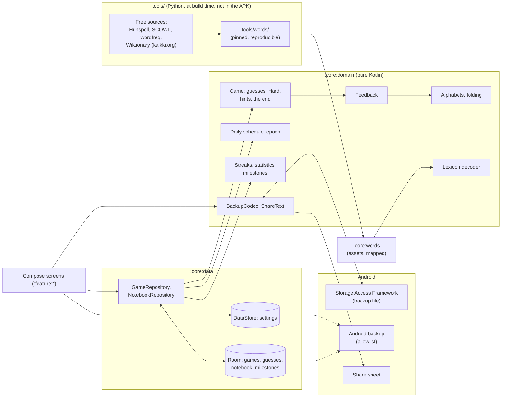

# That's The Word — Technical Planning

> Companion to [VISION.md](VISION.md). This document defines the architecture, the design of the game engine, the words and how they are made, the look of the game, and the delivery phases.
> It is written to be read by humans and by Claude Code.
>
> Keep the phase checklists up to date: tick the boxes as work is merged, and record every decision and deviation with its reason in §15's log. How the log is written and archived is in How it is made, below.

---

## How it is made (12 Nov 2026, as the family's)

- **This file** is the living plan: the architecture and the rules the code keeps (§1 to §10, §12 to §14: living, changed in place with the code, never archived), the phases still open (§11), what is open (§15, Open), and the log of the current period (§15, after Open). New decisions are written **at the end of the log**, one `###` section per intervention, with who asked and the date (and the step, where there is one).
- **`docs/planning/NN-<period>.md`** are the closed periods of the log, with the phases they closed, **frozen**: they are not edited. A decision that changes an old one is written here, naming the one it changes (the file, and the title or the entry's date).
- **`docs/planning/README.md`** is the index of every `##` and `###` heading of the archive, with its line: a reference by name or by date in the code ("PLANNING.md §11 Phase 3", "§15, 12 Nov 2026") that is not in this file is found there. It is written by `python3 tools/planning_index.py`, never by hand, and changes only when archiving. Both arrive in Phase 0, from the family; until the first archive the index is empty.
- **Archive** when the log passes ~80 KB (`sed -n '/^### Log since/,$p' PLANNING.md | wc -c`), or at a release, whichever first. A size and not a count of lines: this file writes a paragraph to a line. The log becomes the next archive file (the same header as the family's: "Frozen on <date>: a closed period of the log, moved here from `PLANNING.md` without changing a line"), and the phases of §11 that closed go with it (a closed phase's open box carried to Open); here an empty log stays with its start date, «Open» is reread, and the index script is run again (`--check` tells if the index is behind).

## State

- **Released**: nothing yet.
- **Done**: Phase 0, the foundations (12 Nov 2026): the vision reviewed and answered, the build, the design system, CI green on GitHub, the debug key and the release key (rehearsed and pinned), the start page in three languages, the mark.
- **Done**: Phase 1, the words (12 Nov 2026): the pipeline (`tools/words/`), the accepted sets, the solutions and their levels, the glossaries of the nine pairs, the daily schedules, the files and their report (`docs/words/README.md`); the owner's go on the meanings, the deny lists and the daily pool.
- **Done**: Phase 2, the game engine (12 Nov 2026): `:core:model`, `:core:domain` (the folding, the marks, `Game` with Hard and the hints, the daily's dates and numbers, free play's draw, streaks, statistics, milestones, the share text, the words' decoder) and `:core:words` (the assets, mapped), every §4.9 case named in a test; the owner's answers to Open 8, 9, 11 and 12.
- **Built**: Phase 3, the game screen (12 Nov 2026): the feedback chosen by the owner (ink and amber), `:core:data` (Room version 1, the settings), the shell on Navigation 3, `:feature:game` (the grid, the keyboard, the refusals, the end card, the motion, the haptics), today's daily from a provisional start page. Its acceptance on a phone (the reveal at the phone's refresh rate with the profiler, TalkBack through a game) is still to be looked at.
- **Built**: Phase 4, the start page (12 Nov 2026): `:feature:home` (today's word in each language with the quick switch, the streak, the calendar of the dailies with the archive's games, free play at a level, Hard), practice replays and another free word from the end card, the change of day seen live, the launcher's shortcuts. Its look on a phone is still to be had, with Phase 3's.
- **Built**: Phase 5, practising a language (13 Nov 2026): the hints in a foreign game, drawn in the rows they spend; the end card's meanings and its notebook marks; `:feature:notebook`; the milestones unlocked and said on the end card. Its look on a phone is still to be had, with Phases 3 and 4.
- **Built**: Phase 6, progress and your data (13 Nov 2026): `:feature:progress` (each language's statistics by mode, the distribution with its latest game, the streaks, hints and Hard counted apart, the milestones reached or how near); the backup file (`BackupCodec`) with Your data's page in `:feature:settings` (a copy saved, a copy read, checked, shown and brought back on the player's yes); the shared picture beside the text. Android's backup with `bmgr`, and the look on a phone, are still to be had.
- **Built**: Phase 7, first run, settings and sound (13 Nov 2026): `:feature:onboarding` (the welcome, the game language, a foreign language's level) and the guided first game (`GuidedGame`, `GuidedLessons`: each rule said once, under the grid); `:feature:settings`' page (how to play, the game, the app's language, the reminder, sound, touch and motion, the appearance, about and the licences); the sounds (`tools/make_sounds.py`, `GameSounds`); the daily reminder (`:core:reminder`). Its look and sound on a phone are still to be had.
- **Built**: Phase 7b, the home-screen card (13 Nov 2026): `:widget` («Today's word», on the family's card: each language's word of today drawn as the start page's tiles, the game language's streak, a row's touch opening its word; its settings page with the real card; redrawn after every game and at midnight), and its row in Settings. Its look on a phone's home screen is still to be had.
- **Built**: Phase 8, accessibility, polish and the README's pictures (13 Nov 2026): two checks more in every screen's tests (no text cut, a heading on every page), the right place's rim on a dark page, the row being typed read back to TalkBack, the lessons' plurals; the hand-written Baseline Profile, checked against the code and compiled into the APK; nine pictures in the README. TalkBack through a whole game and the start-up measured are a phone's.
- **Built**: Phase 1b, the words again (14 Nov 2026): no list of words kept anywhere, the editions' labels instead; a whole definition of two lines in the three languages for every solution; every length from 3 to 8 built, measured and shipped in the app (26.9 MB of word files); the daily schedules written anew. The owner's go on the new samples and the daily pool's size is still to be had (§15, Open 23 to 26).
- **Next**: Phase 9, the 1.0.0 release on GitHub. What is still open (§15) is needed by the phases it names.
- **Later, and optional**: Google Play, F-Droid (§11).

---

## 1. Tech stack

The family's stack, as Tetto carries it from Tempo and Passo (Tetto ADR 0001), at the latest stable versions of 12 Nov 2026 (ADR 0001 here): a step ahead of the sisters' build, which is theirs to follow when they choose.

| Concern | Choice |
|---|---|
| Language | Kotlin 2.4, compiled by AGP 9's built-in Kotlin, with the Compose compiler Gradle plugin; KSP for Room and Hilt |
| Build | Gradle 9.9 with Kotlin DSL, AGP 9.5; version catalog (`gradle/libs.versions.toml`); convention plugins in `build-logic/` (`thatstheword.*`) |
| JDK | Java 21, `jvmTarget` 21, without a Gradle toolchain |
| SDK levels | `minSdk 34`, `targetSdk 37`, `compileSdk 37` (the family's) |
| UI | Jetpack Compose, Material 3 (1.4, stable) in the family's design language (Chiaro's generated schemes, dynamic colour on request), edge-to-edge; the game's own tiles, keyboard, motion and feedback colours (§7). Stable Material 3, as the sisters' (owner, 12 Nov 2026): Material 3 Expressive's APIs are internal in 1.4 and arrive with 1.5, still a release candidate |
| Architecture | MVVM with unidirectional data flow; coroutines and `Flow` |
| Dependency injection | Hilt |
| Persistence | Room for the games, their guesses, the notebook and the milestones (schema exported, every migration tested); DataStore (Preferences) for the settings |
| The words | Generated by a reproducible script (`tools/words/`, Python) from free sources, shipped as compact files in the APK (`:core:words`), read without copying (§6) |
| Serialization | kotlinx.serialization: the navigation routes and the backup file |
| Background | No service, no worker of the game's own. One inexact alarm a day for the daily reminder, only while the player has it on and its notification can show (§8, the owner, §15, Open 15); one inexact, non-wakeup alarm at midnight for the home-screen card, only while one is placed (§7.8) |
| Home-screen card | Jetpack Glance (`glance-appwidget` 1.2.0, the family's), with the WorkManager it runs on pinned at 2.10.5 (Phase 7b) |
| Navigation | Navigation 3, as the family's shell |
| Time | `java.time`, local dates for the daily word; an injected clock and zone |
| Sound and haptics | `SoundPool` with sounds generated by a script in the repository (`tools/make_sounds.py`, no third-party audio); the view's haptic constants, no `VIBRATE` (§7.5) |
| Testing | JUnit 4, Truth, Turbine, coroutines-test; Robolectric (Room, Compose UI tests); Room's `MigrationTestHelper`; Python tests for the words' script |
| Quality | Android Lint (`checkDependencies`), ktlint through Spotless; a Baseline Profile for the start, the first run, the start page and the game (Phase 8: `app/src/main/baseline-prof.txt`, written by hand, `ProfileRulesTest`) |
| CI | GitHub Actions: formatting, the forbidden-permission check on the merged manifest, unit tests and lint before the APKs. A release workflow on version tags builds the signed APK and publishes it to GitHub Releases |
| License | GPL-3.0-or-later (VISION §3). Every dependency and every data source must have a GPL-3.0-compatible licence and the owner's approval; the name and the mark are not covered (VISION §13) |

Always pick the **latest stable** versions at setup time and record them in the version catalog. Avoid alpha versions unless a phase needs them and says why.

---

## 2. Project structure

```
thats-the-word/
├── app/                    # Application, MainActivity, the shell (Navigation 3), DI entry points
├── build-logic/            # Convention plugins (android-application, library, compose, feature, hilt, room, jvm)
├── core/
│   ├── model/              # Pure Kotlin data classes (no Android deps)
│   ├── domain/             # Pure Kotlin: the game engine, the daily schedule, the words' decoder, streaks, statistics, milestones, the share text, the backup format
│   ├── words/              # The word files in assets (written by tools/words/) and their reader
│   ├── data/               # Room (games, guesses, notebook, milestones), DataStore, repositories exposing Flow
│   ├── reminder/           # The daily reminder's Android half: its inexact alarm, receiver, channel and notification (Phase 7)
│   ├── designsystem/       # M3 theme, typography, motion, the tiles, the keyboard's keys, the feedback colours, icons, sounds and haptics
│   └── testing/            # test-only: the accessibility checks and the page walk the UI tests share
├── feature/
│   ├── home/               # Start: today's word per language, the quick language switch, the calendar (archive), free play
│   ├── game/               # The game: grid, keyboard, hints, the end card, sharing
│   ├── notebook/           # The notebook: the words met, searchable
│   ├── progress/           # Statistics, streaks, milestones
│   ├── onboarding/         # Welcome, the languages, the level (the guided first game is :feature:game's)
│   └── settings/           # Settings (Phase 7: how to play, the game, the app's language, the reminder, the home-screen card, sound, touch, motion, appearance, about, the licences) and Your data (Phase 6)
├── widget/                 # The home-screen card (Glance, Phase 7b): its receiver, its settings page, its midnight alarm
├── tools/                  # the words' script, the sounds' script, the launcher icon script, the planning index script
├── docs/                   # ADRs, the planning archive, the words' report, screenshots
├── keystore/               # the shared debug key (deliberately committed)
├── VISION.md
├── PLANNING.md
└── CLAUDE.md
```

Rules:

- `core:model` and `core:domain` are pure Kotlin/JVM modules. All game logic lives there and is unit-tested without Android. The words' decoder is pure too: `:core:words` only maps the files and hands their bytes over.
- Feature modules depend on `core:*`, never on each other. The guided first game is `:feature:game` in its guided mode, opened by the shell after the first run's pages.
- `:widget` depends on `core:*` and is reached by the features only through `HomeScreenCards` (`:core:data`), which it binds; the doors into the game (`TodayDoor`, `:core:data`) are named where the card, the shortcuts and the reminder can all see them.
- `app` wires everything together.
- A module joins the build in the phase that brings its first code, not before (Phase 0 has `:app`, `:core:model`, `:core:designsystem`, `:core:testing`).

---

## 3. Architecture overview



What is fixed at build time (the words, the daily schedule) never changes on the phone; what the player does (games, guesses, notebook) is in Room; what they chose (languages, options, look) is in DataStore. Nothing runs when the app is not on screen.

---

## 4. The game engine (core design)

All of it in `:core:domain`, pure, test-first, every case of §4.9 named in a test. The engine is general in the word's length and the number of attempts from the first line (1.1's modes and 1.2's lengths need it), while the data of 1.0 is five letters and six attempts (VISION §8).

### 4.1 Languages, alphabets and folding

- A **language** is `IT`, `EN` or `ES` (VISION §5), each with its **keys**: the letters the keyboard has and a guess is made of. English: A–Z. Spanish: A–Z and **Ñ**, a letter of its own with its own key (VISION §6). Italian: A–Z on the keyboard (loanwords such as *taxi* or *jeans* are words a player types), solutions only within the Italian alphabet's 21 letters (the owner, §15, 12 Nov 2026, «Open 6 answered»).
- **Folding** turns a written word into its **key form**, the letters as typed: lower case, Unicode NFD, combining marks dropped, then mapped to the language's keys. In Spanish the ñ is kept before the marks are dropped (*niño* → `NIÑO`, *pingüino* → `PINGUINO`, *árbol* → `ARBOL`); in Italian and English every mark goes (*città* → `CITTA`). A word with anything left outside the keys (an apostrophe, a hyphen, a space, a digit) is not a word of the game.
- The **display form** is the word as written (*città*, *árbol*), kept with its key form in the glossary (§6) and shown at the end of a game (VISION §6, §9). Several display forms can share one key form (Italian *pero* and *però*, Spanish *esta* and *está*): the solution's display form is its own; a guessed key form shows each of its forms.
- In memory a letter is its index in the language's keys and a word an `IntArray` (or a packed `Long` where many are compared): no `Char` or `String` arithmetic in the engine, so Ñ is a letter like any other.

### 4.2 The feedback

Each letter of a guess gets one of three marks: **right place**, **elsewhere** (in the word, not here), **absent**. Duplicates are counted, in two passes:

1. Every letter in its right place is marked so and taken off the solution's count of that letter.
2. Left to right, every other letter is marked elsewhere if the solution still has an unclaimed copy of it (and that copy is claimed), absent otherwise.

So a guess with two E against a solution with one E marks one of them, the right-placed one first, else the leftmost. The keyboard shows each letter's best mark so far (right place over elsewhere over absent over unknown).

### 4.3 A game

- `GameSetup`: language, mode (`Daily(date)`, `Free(level)`, `Guided`; 1.1 and 1.2 add theirs), length, attempts (5 and 6 in 1.0), Hard on or off, the solution's key form, the interface language at the start (which decides whether hints exist: VISION §5).
- `Game`: the setup and its **moves**, the guesses and the hints in the order they were made, and what follows from them: the marks (computed, never stored), the letter a hint revealed, the attempts left (`attempts − guesses − hints`), the state (`Playing`, `Won`, `Lost`). A game is taken up by replaying its moves (`Game.restore`).
- `submit(guess)` answers `Accepted(marks)` or `Refused(reason)`: too short; not a word (§6's accepted set, by key form); Hard's rule not kept (§4.4), naming the first requirement missed (the positions left to right, then the letters). A refused guess costs nothing.
- Won when every letter is in its right place; lost when no attempt is left. A finished game takes nothing more.
- A game is saved after every guess and every hint (Room, §5), and taken up where it was left, on any page, after any restart.

### 4.4 The Hard option

Every clue found must be used (VISION §8): a letter found in its right place stays there; a letter found elsewhere is in every later guess, as many times as it was marked (two E marked, two E needed). A letter revealed by a hint counts as found in its right place. Hard is chosen before a game's first guess and holds for that game; the setting applies to the next game, and to a game opened and not yet tried, which takes the Hard chosen since when it is taken up (§15, 12 Nov 2026, «Phase 4»). The start page says which of its words Hard holds for (the word of today's and free play's titles read "· Hard"), and under its switch whether a word already begun keeps the rule it began with (§15, 13 Nov 2026, «The start page's free play and Hard»). The statistics count a game with Hard apart, and its share text says so.

### 4.5 Hints and what they cost

Only in a game whose language is not the interface's (VISION §5, §9); as proposed, confirmed by the owner (§15, 12 Nov 2026, «Phase 2: the game engine», Open 11). Three kinds, each once a game: **translation** (the solution's translation in the interface language), **definition** (a definition in the interface language), **letter** (the leftmost position no guess has yet found in its right place, at the moment the hint is taken, revealed there: the same letter for every player of a daily at the same point; not offered when every position has been found, though not in one guess). Each costs one attempt: the grid's last empty row is spent, and drawn as the hint's row, so the cost is in sight. No hint when one attempt is left: it would end the game. A word with no translation or definition offers no such hint. Games with hints count for the streak, and are marked in the statistics (VISION §9).

### 4.6 The daily word and the archive

- **The epoch** is the date of daily number 1: **1 November 2026**, fixed by the owner before the release (§15, 12 Nov 2026, «Open 10, Open 22 and VISION Q2 answered»), so the archive holds days to play whenever 1.0 comes; never moved again. The daily of a local date `d` is number `d − epoch + 1`, and its word is the language's frozen schedule at that number (§6.5): the same for every player, from the local date alone, with no server (VISION §8). It changes at local midnight.
- A daily game belongs to the **date it was started on**: one started at 23:58 and finished at 00:03 is the earlier day's, for the calendar and the streak.
- **The archive**: every date from the epoch to today, per language, marked solved, missed or not played; future dates are not playable (a phone's clock set ahead is not checked against anything, and needs not be: nobody is competing).
- **The calendar** (`ArchiveMonth`, `:feature:home`): a month of a language at a time, from the epoch's to today's; each day found, missed, under way or not played, drawn as the game draws a letter (the right place's ink square, the absent tile sunk, elsewhere's amber round, the empty tile), a day caught up later from the archive with a dot; the days ahead and those before the epoch faint, not playable. A past day is touched to play it, take it up or see it.
- **A day's result is its first finished game** (the owner, §15, 12 Nov 2026, «Phase 2: the game engine», Open 9). A day already finished can be played again as practice: not counted, not in the calendar, not in the notebook's marks. It is offered on the end card of the day's game ("Play it again, as practice"); a replay left unfinished is taken up, and its result is not shared.
- The schedule must outlast the app: the script writes at least ten years from the epoch, and a test fails when fewer than three years are left from the build's date.

### 4.7 Free play and the levels

- Four **levels** by frequency (VISION §9), cumulative: Base ⊂ Intermediate ⊂ Advanced ⊂ Complete (the owner, §15, 12 Nov 2026, «Phase 2: the game engine», Open 12). The level is the game language's own (an Italian player can be at Complete in Italian and at Base in Spanish); in a foreign language it starts at Base.
- **Free play** keeps one game under way a language: the start page takes it up, whatever its level, or **leaves it for a new word** at the level chosen (the owner, §15, 13 Nov 2026, «The start page's free play and Hard»): a word tried opens on its own page with the question, over its rows (§15, 13 Nov 2026, «A word left, on its own page»), and on the player's yes is lost, as any move that ends a game is saved: counted as missed, its solution in the notebook, the milestones it reached said on its end card, so no word is left behind unseen, with another word one touch away; a word never tried simply gives way, with no trace. A daily is never left. The end card offers another word at the language's level. It draws a solution at the level, never one of the language's last 200 free games nor one solved in free play before, until the level runs out (then the oldest come back: the word whose last free game is the longest ago). The daily draws from Base and Intermediate only, because it is the same for everyone (VISION §9).

### 4.8 Streaks, statistics and milestones

- **Streak**, per language: the run of consecutive dates, ending today or yesterday, whose daily was won on its own date (§4.6), hints or not. Today's word missed ends it at once, not at midnight (§15, 12 Nov 2026, «Phase 4», Open 22). A daily won from the archive counts in the statistics and the calendar, never in the streak (VISION §11). The longest streak is kept as the statistics' answer, computed, not stored.
- **Statistics**, per language and mode: games, the share won, the distribution of the games won by the attempts they used (a hint is one, §4.5: the number a result shares, «4/6»), the games with hints, the games with Hard. Computed from the games table by query, never kept as counters that could drift.
- **Milestones** (VISION §11): a closed list in the domain, each a predicate over the facts (the games, the notebook) and a sentence in the three languages; checked after every finished game and every notebook change, unlocked once with its date, never taken back. The first list, from the vision: seven dailies in a row (a streak of seven, in one language); a first win in a foreign language (a counted game of any mode); 100 words in the notebook; a day's daily won in all three languages (the date's counted result, from the archive too). Recognition, never a key (VISION §11).

### 4.9 Edge cases (all need unit tests)

| Case | Expected |
|---|---|
| A guess with a letter twice, the solution with it once, one in its right place | That one right place, the other absent |
| A guess with a letter twice, the solution with it once, neither in place | The leftmost elsewhere, the other absent |
| The solution with a letter twice, the guess with it once, out of place | Elsewhere |
| Spanish *ñ* against *n* | Two different letters: `AÑOS` and `ANOS` differ |
| Italian *città* typed as `CITTA` | Accepted; the end card says *città* |
| A key form with two display forms | Both shown for a guess; the solution's own for the solution |
| Hard: a right-place letter moved | Refused, naming the position |
| Hard: an elsewhere letter twice, guessed once | Refused, naming the letter |
| Hard and the letter hint | The revealed letter required in its place |
| A hint with one attempt left | Not offered |
| Three hints, then three wrong guesses | Lost, six attempts used |
| A daily started 23:58, finished 00:03 | The earlier date's, for the streak and the calendar |
| A daily played at 23:59 in Rome and at 00:01 after flying to London | Each local date its own word; no game is moved |
| The daily of a date before the epoch, or after today | Not playable |
| A day finished, then replayed and won | The first result stands |
| Daylight saving's change at night | One date, one word |
| The streak with yesterday's daily won and today's not yet played | Still running |
| The streak with yesterday missed | Ended; today's win starts at 1 |
| The streak with today's word missed | Ended at once (Open 22) |
| An archive win for a missed day | Calendar solved, statistics counted, streak untouched |
| Free play at a level where every word was played | The oldest come back |
| A free word tried, left for a new one | Lost, over, counted as missed; taken up and backed up as left (`lost` with attempts left) |
| A free word never tried, left for a new one | Gone, no trace; a daily is never left |
| The schedule shorter than three years from the build date | A test fails |

---

## 5. Data model

### `:core:model` (pure)

`Language`, `Letter` (an index in a language's keys), `Word` (key form), `Mark` (right place, elsewhere, absent), `Guess`, `GameMode`, `GameSetup`, `GameState`, `Level`, `HintKind`, `NotebookEntry`, `Milestone`, the settings enums and `UserSettings`, the appearance (`ThemeMode`, `AppPalette`, `AppFont`); the home-screen card's look (`WidgetLook`, `WidgetGround`, `WidgetCardColor`).

### Room (`ThatsTheWordDatabase`, file `thatstheword.db`, version 1, from Phase 3)

| Table | Columns | Notes |
|---|---|---|
| `games` | `id`, `language`, `mode`, `daily_date` (epoch day, for a daily), `level` (for free play), `solution` (key form), `length`, `attempts`, `hard`, `ui_language`, `status`, `started_at`, `started_on` (the local date it was started on, an epoch day), `finished_at`, `practice` (0 for the counted game, 1, 2… for a finished day's replays) | A daily's counted game unique per `(language, daily_date)`: a unique index on `(language, daily_date, practice)` (§15, 12 Nov 2026, «Phase 3: the game screen»). The marks are never stored: they follow from the solution and the guesses. A `status` of `lost` with attempts left is a free word left for another (§4.7), the one state the moves cannot say |
| `guesses` | `game_id`, `position`, `word` (key form) | Cascade on the game's delete |
| `hints` | `game_id`, `kind`, `position` | One `position` sequence with the guesses: a game is its moves in order (§4.3), and the letter a hint revealed follows from the guesses before it |
| `notebook` | `language`, `word` (key form), `first_met`, `last_met` (local dates, epoch days), `times_met`, `solved`, `missed`, `with_hints`, `saved_by_hand` | One row per word and language: the solutions by themselves, written when a counted game ends, in its transaction (a replay changes nothing); a guessed word when the player adds it from the end card (the owner, Open 8), taken back by a second touch while no game hid it. The meanings are read from `:core:words`, never copied (`Notebook`, `Lexicon.meaning`). 1.1's review adds its columns by a tested migration |
| `milestones` | `id` (the milestone's name in lower case), `unlocked_at` (an instant) | Asked after every finished game and every word added, in the same transaction; unlocked once |

Never `fallbackToDestructiveMigration`; the schema is exported to `core/data/schemas/` and committed; every migration has a test, and the upgrade from the first release's schema is tested.

### DataStore (Preferences), file `settings`

The game language; the level per language; Hard; sound, haptics, reduced motion (the system's by default); the appearance (theme, dress, typeface, wallpaper colours); the first run done; the first-day tips seen; the daily reminder and its hour (`reminder`, `reminder_minute`, minutes from midnight); whether the phone was ever asked for the notification permission (`asked_notifications`, the phone's: neither a backup nor a restore carries it). The interface language is not here: it is the system's per-app language (`locales_config.xml`), opened from Settings.

### DataStore (Preferences), file `widgets` (Phase 7b)

Each home-screen card's look, by its `appWidgetId`: its ground, its colour, its opacity; and the version the picker's preview was published for. **Not backed up**: a restore renews the cards' ids, and a look kept under an old id would dress nothing, or the wrong card. A removed card takes its look with it.

### Backup

- **Android's backup** (`data_extraction_rules.xml`, an allowlist from Phase 0): the database and the settings file. The words ship in the APK and are never copied.
- **The backup file** (VISION §11): the games (each with its moves in order), the notebook, the milestones and the settings, as versioned JSON (`BackupCodec`, kotlinx.serialization, `format` `thatstheword-backup`, version 1), written and read through the Storage Access Framework. A restore is read whole and checked (not a backup, a newer version, damaged) before anything is written: every word typed in its language's keys, every game replayed into the state it says (a free word left says `lost` and replays under way, with a move at least: no other game may), no move after the end, a day's counted game once and its replays after it, one free game under way a language, and every daily the frozen schedule's word of its date (`BackupRepository.fits`). It says what it holds and what it replaces, and replaces only after the player's confirmation, in one transaction, then the choices (the first-day tips stay the phone's), as the family's.

---

## 6. The words

The words are the riskiest part of the game, and the heaviest (VISION §10, §16 questions 3 to 5): Phase 1 builds them first and measures them before anything is drawn.

### 6.1 Sources

| Data | Source | Licence | To check in Phase 1 |
|---|---|---|---|
| Italian words, every form | Hunspell `it_IT` (LibreOffice dictionaries), expanded | GPL-3.0 | The version and its affix rules |
| Spanish words, every form | Hunspell `es` (the RLA-ES project, 2.9: Spain's, Mexico's and the Río de la Plata's), expanded | GPL-3.0-or-later / LGPL-3.0-or-later / MPL-1.1 at the user's choice (checked on the release, `es/LICENSE.md`): used under GPL-3.0-or-later | Done (Phase 1) |
| English words, both spellings | SCOWL 2020.12.07 (up to size 70 for the accepted set), with its British and American lists; a solution must be in both. ENABLE was not needed | SCOWL's own permissive notice | Done (Phase 1) |
| Frequencies | `wordfreq`'s data (frozen since 2024), cross-checked with OpenSubtitles lists | CC BY-SA 4.0 | The thresholds of the four levels |
| Meanings, translations, parts of speech, written forms | Wiktionary, as extracted by wiktextract (kaikki.org): the English, Italian and Spanish editions | CC BY-SA 4.0 and GFDL | Coverage per language pair (§6.4) |

The expansion of Hunspell's affixes is done by a tool run at build time, never shipped: the pipeline's own pure-Python expander (`tools/words/pipeline/hunspell.py`, this repository's code). Every source's version, checksum and licence is in `docs/words/README.md`; the choices made on them in `docs/adr/0003-words.md`. Every source is downloaded by the script at a pinned version with its checksum, into a cache outside the repository; what ships is only what the script writes.

### 6.2 The two sets

- **Accepted** (VISION §10): every form of the right length, inflected ones included, as wide as the sources allow: fewer unfair refusals. Folded to key forms (§4.1), duplicates merged.
- **Solutions**: base forms only (a Wiktionary lemma, not a "form of"), no proper nouns, abbreviations, no word with two spellings in English, no Italian word outside its alphabet's 21 letters (§15, 12 Nov 2026, «Open 6 answered»). Every solution is in the accepted set, and has a whole meaning of two lines at most in each of the three interface languages (§6.4): a word without one is not a solution.
- **No list of words to avoid** (the owner, §15, 14 Nov 2026, «Phase 1b»): what keeps a word out is the editions' own labels, read in every edition that has the word (`tools/words/pipeline/register.py`: tags, usage notes, categories; never a word). **Coarse** (vulgar, obscene, offensive, a slur, a swear word) and **derogatory** (derogatory, pejorative): a solution has neither in any sense of any edition (*palla*, *colpo*, *rosso* are guesses, never words to find); **intimate** (the editions' topics of sex): a solution's first sense is not. A guess is **refused** (the word is not in the game at all) when an edition's first sense of it (a form's «plural of» included) is coarse, or more than half of the senses of its first entry there are, or every edition puts a derogatory sense first; a form whose every lemma (or Hunspell stem) is refused goes with it. A key form any of whose written forms Wiktionary refuses is refused whole: a guess is typed without accents, so an innocent accented form sharing its letters does not keep a refused word in the game (§15, 14 Nov 2026, «Three ideas»). A Spanish «vulgarismo» (a substandard form) is not a coarse label. A refused word is in no file and no list of the report: the report counts, never names, them, and the repository holds no list of them.
- **What a solution is** (the owner, §15, 14 Nov 2026, «Three ideas»): a noun, an adjective or a verb by its first entry (`config.SOLUTION_KINDS`); an adverb, a pronoun, a preposition, a number stays a guess. At most `config.MAX_SOLUTIONS` a length, the most frequent kept (it binds at eight letters only).

### 6.3 Levels

Each solution gets a frequency (Zipf, from `wordfreq`) and its level from four thresholds per language, chosen in Phase 1 so that Base reads as a learner's first thousand words and Complete takes everything left. The thresholds are written in the script with the counts they give, in the words' report.

### 6.4 Meanings and translations

What the end card, the hints and the notebook show is always in the **interface language** (VISION §5). For each of the nine pairs (game language × interface language):

- **The same language**: the word's own definition, from its language's Wiktionary edition (an Italian word in Italian from the Italian edition).
- **A foreign word**: its translation into the interface language, and a short meaning in the interface language. The meaning comes **through the translation**: the translation's definition in its own edition and of the word's part of speech, read in the sense whose translation table holds the word (*heart*'s organ, whose table has *cuore*), else in the first sense of its first entry, so the three languages describe one sense; a second or third translation is read only in a sense its table names (*canna* is never read through *porro*'s music). With no reliable translation, the meaning may still be read through what one source gives for the word's first sense; the translation is then not shown. Else the meaning is the interface edition's own gloss of the word, when it defines rather than names (the English edition glosses most Italian words with their translations: «help, assistance, aid» is not a meaning).
- A word whose translation is unreliable (no sense matched, several unrelated senses) has none: the end card shows the meaning alone (VISION §9), and 1.1's Translate and Bridge never use it (VISION §10).

**A meaning** (the owner, §15, 14 Nov 2026, «Phase 1b»): a whole definition of at most 100 characters (two lines on a phone) and two words or more, **never cut with an ellipsis**. A gloss too long is shortened where a clause (`;`) or a sentence ends, its asides in brackets dropped, or, last, at its first comma when what comes before is a phrase of its own (*città*, «centro abitato di grandi dimensioni»: three words of meaning at least, not a qualifier opening with a preposition, not ending on a conjunction); else a finer sense under the first one is read (not a figurative one); never a later, rarer sense in the first one's place (*oveja* read as mutton, *media* as a shipping loss), nor another homograph's than the word's (the one whose table holds the English edition's first gloss, *avión* the aeroplane, not the bird; else the first); else the word has none, and a word without one in each of the three languages is not a solution. Two words of meaning at least, articles and prepositions not counted: «a dog» is a synonym, not a definition. A meaning never comes from a sense the editions label coarse, derogatory or intimate; never holds a word no guess may be; never points elsewhere («synonym of», «plural of», «grafía de») or leans on the sense before it («bulbo de esta planta»); for a foreign word (the hint reads it) never names the word or its stem. It is written with a capital and no final full stop, in every language alike. Its first clause or sentence is preferred when it defines on its own; a fragment is never one (a qualifier opening with a preposition and no verb, a phrase ending on a preposition, a relative clause cut before its verb), nor a quotation, nor a cross-reference number. A foreign word's translations come in the order of its part of speech, so a noun is never explained through a verb. **The part of speech** is written beside the meaning, in the interface language (*sostantivo*, *noun*, *sustantivo*), when the meaning was read in an entry of the word's own part of speech: the glossary's fourth field, shown in italics on the end card and in the notebook.

Phase 1 measured the coverage of each pair on the solutions, and a sample of 50 words per pair is read by a person before the owner decides (VISION Q4); Phase 1b measures it again under these rules.

### 6.5 The daily schedule, frozen

Per language, the list of the dailies' words in order, written by the script from the Base and Intermediate solutions, shuffled with a recorded seed, at least ten years long. It is **append-only** (VISION §10): the script reads the committed file, refuses to change any entry already there, and only adds at its end. (Written anew once, before 1.0, with Phase 1b's rules: the owner, §15, 14 Nov 2026; no player had a daily yet.) It stores the words themselves (their key forms), not indices into a list that a later source could reorder. It is not plain text, so a glance at the repository spoils nothing; a determined reader can always decode it (the code is open), which is accepted: nobody is competing.

### 6.6 What ships, and how it is read

Every length from 3 to 8 is built with the same rules, measured in the report's «The lengths», and shipped (`config.LENGTHS`; the owner, §15, 14 Nov 2026, «Every length in the app»): 1.1's Bridge and 1.2's variable length find their words in the app already; five letters are 1.0's game, and the only daily schedule (a length's is written with the mode that plays its dailies). Per language, a few files per length in `:core:words`'s assets, uncompressed in the APK so they can be mapped, not copied: the accepted key forms, sorted and packed (five bits a letter: a five-letter word in four bytes, up to six letters, and eight bytes from seven to twelve), found by binary search; the solutions with their levels; the daily schedule; the written forms of each key form (a solution's own first: §15, 12 Nov 2026, «Phase 2: the game engine»); per interface language, one glossary for every length (meanings, translations), in blocks with an index. The decoder is pure Kotlin in `:core:domain`, tested on the JVM against small files the tests write; `:core:words` maps the assets and hands their bytes over. The sizes are measured in Phase 1 (VISION Q5), the formats chosen then, in `docs/adr/0003-words.md`.

### 6.7 Reproducibility and credit

`tools/words/` is a Python package with its own tests: one command rebuilds every file from the pinned sources, and a second run writes the same bytes. Its report (`docs/words/README.md`) gives each source's version, licence and checksum, the counts per set and level, the coverage per pair, the sizes. Each source is credited in `licenses/README.md` and in Settings, About (VISION §10).

---

## 7. The look and feel of the game

### 7.1 The family's language, and where a game departs

The family's design system, copied (ADR 0002): the generated dresses (Paper and Vivid), Google Sans, Inter or the phone's sans, the shapes, the springs, the page gutter, the accessibility checks; one sentence before a number; every number with the line that says what it means; no dead control. A game departs where it must (VISION §12): capitals with wide tracking for the name and the short lines above a title (`wordmark`, `eyebrow`), tiles, a keyboard, livelier springs for the game's moments (`ThatsTheWordMotion.playful`), sound, and colours of its own for the feedback that never follow the dress or the wallpaper.

### 7.2 The feedback: colour and shape together (the owner's direction, 12 Nov 2026)

The marks are said by colour **and** shape (VISION §6), never colour alone, and the palette is the game's own (VISION §13):

| Mark | Colour | Shape | Letter |
|---|---|---|---|
| Right place | a deep ink blue (`#233A7A`) | the tile stays square (corner 22%) | white |
| Elsewhere | the family's amber | the tile becomes round (corner 50%): "somewhere in the word" | dark ink |
| Absent | the dress's quietest ground, no border | the tile sinks (lower, smaller by 4%) | the quiet ink |

On a dark page (the dark dresses, a dark wallpaper's colours) the right place carries a rim of its own hue, `#9DB0EA`, 1.5 dp on a tile, a key, a badge or a bar, 1 dp on a small glyph (`FeedbackColors.RightPlaceRim`, `rightPlaceRim()`, `markGround`): there the ink blue is nearly as dark as the page and as an absent letter's ground, both square, and the rim keeps it 3:1 from every dark ground (`ContrastTest`), as the home-screen card's rim does (§7.8). On a light page, and in the shared picture, there is none (§15, 13 Nov 2026, «Phase 8»).

Square for *here*, round for *somewhere else*: the shape alone says it, in grey, under every colour blindness, and in the share text (§7.6). The two colours are an ink blue and an amber, apart under all three colour blindnesses, tritanopia included, and apart from the genre's well-known green, yellow and grey. Each letter ink is pinned at 4.5:1 on its ground by `ContrastTest` (`FeedbackColors`, `markStyle`). Chosen by the owner on a board of three (§15, 12 Nov 2026, «Phase 3: the game screen»): the berry of the first proposal gave way to the ink, the safest pair. On the keyboard each key takes its letter's mark: the colour, and a small square or dot in its corner for the shape; an absent letter's key sinks into the page.

### 7.3 The grid and the keyboard

- Under the grid, while a game is played, the key of the marks: each mark's tile in small with its words ("Right place", "Elsewhere", "Not in the word"), quiet, wrapping at a large text size (the owner, §15, 12 Nov 2026, «Open 10, Open 22 and VISION Q2 answered»). The row being typed frames its next empty tile as a typed tile's, where the next letter goes. A game in Hard says so above its title ("English · #20 · Hard").
- The grid: the word's length across, the attempts down, the tiles as large as the column allows (56 dp on a phone, never under 44), centred; a hint's row drawn where the spent attempt was, the first hint in the last row and the next above it, so a hint never moves: the letter as a right-place tile in its position (the row's other tiles faint), the translation and the definition as a band the grid's width with the hint's icon.
- The hints (§4.5), in a game whose language is not the interface's: a light bulb in the top bar opens them **in the keyboard's place**, the three with what each gives, where each stands (one attempt, taken, not for this word, not on the last attempt, every place found) and the cost said once above them ("Each costs an attempt: a row of the grid is spent."). A touch takes one and brings the keyboard back: the touch that opened the panel is the first of two, so no hint is taken by a slip. The definition hint shows the meaning alone, never the translation it was read through.
- The keyboard: QWERTY in the three languages, with Ñ beside L in Spanish; Enter and Delete on the bottom row; every key at least 48 dp tall and a full row's share wide; each key in its letter's best mark, by colour and a small mark of its shape. A hardware keyboard types too. The phone's own keyboard is never used: the game's keys are its surface.
- Refusals are said in one line above the keyboard ("Not in the list", "The second letter must be A"), never a toast, and the row shakes.

### 7.4 Motion (VISION §12)

Every moment has its movement, every movement collapses to a fade under reduced motion (the system's setting, or the in-app switch), and no animation gates information.

| Moment | Movement |
|---|---|
| A letter typed | the tile pops (1.08 and back) with the game's spring |
| A row revealed | tile by tile, 70 ms apart, the mark's colour fills from the tile's centre while its corner moves to its shape; never the genre's flip |
| A word refused | the row shakes sideways on a spring, the line above the keyboard says why |
| A word found | the row's tiles lift one by one in a wave and settle, and the line the name stands for arrives: «That's the word.», «Ecco la parola.», «Esa es la palabra.» (VISION §2), in the interface's language; the end card rises |
| A milestone | its sentence arrives on the end card with a soft light across it, once |
| A hint taken | its row arrives on the game's spring where the attempt was spent (the letter revealed as a row's tile is) |
| The start page | the sample word's tiles arrive one by one (Phase 0) |

### 7.5 Haptics and sound

- **Haptics** through the view's constants (`KEYBOARD_TAP` on a key, `SEGMENT_TICK` per revealed tile, `REJECT` on a refusal, `CONFIRM` on a win), so the phone's own touch-feedback setting is followed and no `VIBRATE` is needed; the in-app switch (VISION §12) turns them all off.
- **Sound**: seven short sounds written by `tools/make_sounds.py` from code, the standard library only, the same bytes at every run (`--check`; no third-party audio, no licence to carry), 22,050 Hz 16-bit mono WAV in `:core:designsystem`'s `res/raw` (about 200 KB): a key (a muted wooden tick), a revealed tile (a marimba's note a mark, the right place highest, elsewhere a fifth under, absent a low muted note, so a row plays its result as a phrase), a refusal (two low notes falling), a win (the arpeggio, on a bell), a milestone (a shimmer of bells). Played by `SoundPool` (`GameSounds`, the game's usage) while the game page is started, released when it stops; silent when the phone is on silent or vibrate, read at each sound; the in-app switch turns them off, on by default (the owner, §15, Open 13).

### 7.6 Sharing a result (VISION §11)

Without the word, in the app's own format, from a sheet that shows the picture as it will be sent: a **text** for any messaging app ("That's The Word · #123 · Italian · 4/6", Hard and hints said), with a row of symbols per guess that keep the shapes (🟦 right place, in the right place's ink, 🟠 elsewhere, ▫️ absent: the owner, §15, 12 Nov 2026, «Open 21 and VISION Q1 answered»; never the genre's coloured squares), and an **image** card (the grid's shapes and colours, the date, the language, no letter), shared through a `FileProvider`, which needs no permission. The picture (`ResultPicture`, 1080 × 1350) is drawn on the Paper dress's light ground whatever the player wears (`PictureColors`), the name in its tracked capitals over a short berry rule, the language with the daily's number (or free play), the date, the full grid (the rows not played as empty frames, a row spent on a hint as a quiet band at the foot, as the game draws it), the score and Hard and the hints; written to the cache's `shared/` only, the one folder the provider serves.

### 7.7 Accessibility (VISION §12)

TalkBack reads a row as one sentence ("Row 2: C, elsewhere; A, right place; …"), a key with its letter and mark, the reveal's result once it ends (a polite live region), and every refusal. The row being typed says where the player stands and reads back what is typed, as a text field does (a polite live region: "Row 3 of 6: type a word", "Row 3 of 6, typing: C A"). Every page has a heading on its first screen, for TalkBack's headings navigation. Text at twice its size: the pages scroll, the tiles keep their drawing (their letters are sized by the tile). An open foldable shows a centred column. Every screen's tests run `assertAccessible()` and `walkPage()` (`:core:testing`).

### 7.8 The home-screen card (Phase 7b; the owner, §15, Open 15)

**«Today's word»**, one card on the family's card (`docs/adr/0004-home-screen-card.md`): the launcher's corner, the family's insets (14 dp; 6 dp top and bottom on a row; 8 dp on one cell), its grounds (light, dark, as the phone, one of the family's six colours, blue by default), its opacity and its ink rule (`widgetInk`: the card is its own ground from half opacity, the wallpaper's hint below it), the family's type steps (`WidgetType`). It says today's word in each language, drawn as the start page draws it, in tiles without letters: found, five squares in the right place's ink blue (with a light rim on a dark ground, where the ink blue is as dark as the card); missed, five sunk tiles; under way, the elsewhere's amber circle leading empty frames; waiting, five empty frames. Then the game language's streak, in words ("6 days in a row in Italian"). The shapes say it with the colours, and every row says it again in words; TalkBack reads a row as one sentence ("Italian: found in 4 attempts").

- **The forms** (`CardFit`, `:core:domain`, pinned by `CardFitTest` at the family's reference grants; one cell 85 dp; rows 85, 189, 293; two, three, four cells 159, 250, 340): **tall** (two rows and up), the eyebrow ("TODAY'S WORD · #13", or "#13" where narrow), the date, a row per language (its name, its five tiles, its status), the streak's line; each part given up, where it does not fit, in the order the card can best spare it (the date, the status, the name for its code, the streak's line), and last the five tiles for the day's one; **a row** (one row high), a column per language (its name or code over its tiles over its status) and the streak's own column (the figure, "in a row") where it fits; **one cell**, the three codes, each with the day's one tile (the calendar's glyph), or at a large text size the game language's alone. A tile is never larger than 28 dp nor smaller than 9 dp (a glyph than 8). Nothing is cut: `WidgetFitTest` lays every form out 5% wider than measured, in the three languages and at larger text sizes; the arithmetic reads the text size off Android's own (non-linear) scaling.
- **Touches**: a language's row opens its word of today (`TodayDoor`, the door the shortcuts and the reminder use); the rest of the card, the game. Before the first run is done, the request waits for its end, as a shortcut's does.
- **Pushed, never polled** (§9): after every game that changes what the card shows (`WidgetUpdater`, from the games' and the settings' flows, once the write is committed; a guess that leaves the day as it stood redraws nothing), at midnight (one `AlarmManager.set(RTC)`, inexact and non-wakeup, a second past the next local midnight, armed after every render while a card is placed, disarmed with the last card), on the exempt broadcasts (the clock, the zone, the language, the game updated) and when the interface's language changes under a running game. Whatever asked stays until the card is drawn (`WidgetRefresh`). A card that cannot read the games says so, never Glance's spinner; a card that cannot be drawn says so in the game's words (`WidgetFailure`).
- **Its settings page** (the launcher's long press, and on placing it; optional): the real card, composed by Glance and inflated as a launcher does, at the size it has and the reference sizes; what it stands on, the colour, the opacity; every choice saved as made; «Reset this card». In the player's appearance.
- **The pin request**: Settings' «Home screen» row adds it where the launcher takes the request, says so once it is there, and says how to add it from the launcher's widgets where it does not.
- **The picker's preview**: from Android 15 the real card, drawn from a sample day (`WidgetSamples`), published once per version; below it, a static layout of the default card.

---

## 8. Notifications and system surfaces

- **The daily reminder** (the owner, §15, Open 15; Phase 7): off until the player turns it on in Settings, which asks for the notification permission then and only then. One quiet notification at the player's hour (20:00 until they choose another), only if today's word in the game language is not finished yet, gone at midnight (`setTimeoutAfter`), gone when the app is opened; a touch opens today's word. One inexact alarm a day (`setAndAllowWhileIdle`, no exact-alarm permission), armed again after a boot, an update, a change of the clock or the zone, and of the notifications' state; no alarm at all while it is off or its notification could not show. `:core:reminder`, the family's evening reminder carried over; its channel is `reminder`, its status-bar icon the mark's tiles in one ink.
- **A home-screen card** (the owner, the same answer; Phase 7b): today's word per language and the streak, on the family's card (§7.8).
- **Launcher shortcuts** (no permission): "Today's word" per game language, opening the daily directly, the game language first (Phase 4). Published by code (`TodayShortcuts`), not declared in XML: a static shortcut names its package, and the debug build's is another (`.debug`), as the family's.
- **Predictive back** everywhere (`enableOnBackInvokedCallback`), edge to edge.

---

## 9. Battery rules (non-negotiable)

1. No service of any kind, no polling, no wakelocks, no periodic work, no exact alarms.
2. Nothing runs while the app is not on screen. The change of day is noticed by a ticker in a visible page's lifecycle (the start page, the calendar), never by an alarm.
3. Sounds are loaded while the game page is visible and released when it is not.
4. The words are mapped from the APK, never copied or decompressed into storage at the first launch.
5. The daily reminder (§8): one inexact alarm a day, only while it is on and its notification can show, as the family's.
6. The home-screen card (§7.8): pushed, never polled; one inexact, non-wakeup alarm at midnight, only while a card is placed. Glance draws it on the WorkManager it brings (its jobs and their wake lock are the library's, held while a card is drawn); the game's own code starts no service and holds no wake lock.

---

## 10. Permissions and manifest

| Permission / element | Type | Why |
|---|---|---|
| (none of the game's own) | | |
| `POST_NOTIFICATIONS`, `RECEIVE_BOOT_COMPLETED` | Runtime / normal | The daily reminder (§8, `:core:reminder`): the permission asked only when the player turns it on; the boot broadcast to arm its alarm again |
| `WAKE_LOCK`, `FOREGROUND_SERVICE`, `ACCESS_NETWORK_STATE`, `RECEIVE_BOOT_COMPLETED` | Normal, WorkManager's | Brought by Glance's WorkManager with the home-screen card (§7.8), as in the family's cards: held by its jobs while a card is drawn; `ACCESS_NETWORK_STATE` lets nothing leave the phone (there is no `INTERNET`) |
| `android:allowBackup="true"` + `dataExtractionRules` | Manifest | The database and the settings file only (§5) |
| `android:appCategory="game"` | Manifest | The system's game features (game mode, the launcher's grouping) |

**Forbidden:** `INTERNET`, `ACCESS_*LOCATION`, `REQUEST_IGNORE_BATTERY_OPTIMIZATIONS`, `SCHEDULE_EXACT_ALARM`, `USE_EXACT_ALARM`, `com.google.android.gms.permission.AD_ID`, `ACCESS_ADSERVICES_*`, `CAMERA`, `RECORD_AUDIO`, `READ_SMS`, `RECEIVE_SMS`, `SEND_SMS`, `READ_CONTACTS`, `WRITE_CONTACTS`, `GET_ACCOUNTS`, `READ_CALENDAR`, `WRITE_CALENDAR`, `READ_PHONE_STATE`, `READ_EXTERNAL_STORAGE`, `WRITE_EXTERNAL_STORAGE`, `MANAGE_EXTERNAL_STORAGE`, `READ_MEDIA_*`, `QUERY_ALL_PACKAGES`, `ACTIVITY_RECOGNITION`, `HIGH_SAMPLING_RATE_SENSORS`, `BODY_SENSORS*`.

The backup file goes through the Storage Access Framework (`ACTION_CREATE_DOCUMENT`, `ACTION_OPEN_DOCUMENT`), which needs no storage permission; sharing goes through the share sheet and a `FileProvider`; haptics through the view's constants, which need no `VIBRATE`.

`checkForbiddenPermissions` (build-logic, `ForbiddenPermissionPatterns`) checks every variant's merged manifest, is wired to `check`, and runs in CI and in the release workflow. A library that adds one is removed or patched with `tools:node="remove"`.

---

## 11. Delivery phases

Each phase ends with a merged PR, green CI and its acceptance criteria met. Phases 3 to 7b need **a look on a physical device**: the motion at the phone's refresh rate, the haptics, the sounds, TalkBack, a backup restored on a clean install.

**How to run a step** (the family's): one step is one session. Read CLAUDE.md, the step and the files it names; build it with its tests (the domain's first, for anything that decides a mark, a word, a date or a streak); run `spotlessApply`, `test`, `:app:lintDebug` and `:app:checkForbiddenPermissions`; look at the screenshots the step changes (`build/screenshots`); tick the step, record its decisions in §15, and add its line to `CHANGELOG.md`'s Unreleased section in the player's words. A step that changes a decision already recorded says so, and the owner confirms it before anything is built.

Phases 0, 1 and 2 are closed: their steps and acceptance are archived in `docs/planning/01-2026-11-12-to-13.md` (§15, 14 Nov 2026).

### Phase 1b — The words again (the owner, §15, 14 Nov 2026)

- [x] No list of words to avoid, anywhere: the deny lists removed, the editions' labels read in every edition (`tools/words/pipeline/register.py`), a word they keep out counted in the report and never named (14 Nov 2026)
- [x] A refused guess: a word that is first or mostly coarse, or first derogatory in every edition, is not in the game at all, with its forms (14 Nov 2026: 54 Italian, 391 English, 176 Spanish five-letter forms)
- [x] Every solution with a whole meaning of 100 characters at most, never cut, in the three languages, of its first sense or the sense its translation names (14 Nov 2026: 717 Italian, 1,355 English, 1,068 Spanish solutions)
- [x] Every length from 3 to 8 built with the same rules and measured in the report (14 Nov 2026), and shipped in the app, one glossary for them all (the owner, 14 Nov 2026, «Every length in the app»)
- [x] The daily schedules written anew, once, before 1.0 (14 Nov 2026)
- [ ] **The owner's go** on the new samples (`docs/words/samples/`) and on the daily pool's size (Open 23, 24)

**Acceptance:**
- [x] A search of the repository finds no word the labels refuse, in the files the app ships, the report and the lists (14 Nov 2026: checked against every refused word of the three languages)
- [x] A second run of the script writes the same bytes (14 Nov 2026)
- [ ] The owner's go (Open 23, 24).

### Phase 3 — The game screen

- [x] The feedback's colours and shapes drawn on a board (three proposals, light and dark, under the three colour blindnesses and in grey, with the reveal's motion), **chosen by the owner** (B, ink and amber), then `ContrastTest`'s pairs (12 Nov 2026)
- [x] `:core:data`: `ThatsTheWordDatabase` version 1 (§5), the schema exported; `GameRepository` (a game saved after every guess and hint, taken up where it was); `SettingsRepository` (12 Nov 2026)
- [x] The shell (Navigation 3); `:feature:game`: the grid, the keyboard with its marks, the refusals' line, the end card (the solution and its display form, the guesses, share), the hardware keyboard (12 Nov 2026)
- [x] The motion of §7.4, the haptics of §7.5; the reduced motion's fades (12 Nov 2026; the milestone's light is Phase 5's, with the milestones)
- [x] The daily in the game language from a provisional start page (12 Nov 2026)
- [x] UI tests from states, with `assertAccessible()` and `walkPage()` at twice the text size and on an open foldable; TalkBack's sentences; the screenshots looked at (12 Nov 2026)

**Acceptance:**
- [ ] A daily played from start to end, closed in the middle and taken up again. On the JVM (12 Nov 2026: `GameViewModelTest`, through the page's view model, Room and the real words); on a phone, to be looked at.
- [ ] TalkBack reads a revealed row as one sentence; at twice the text size nothing is cut. The sentences and the large-text pages are tested (12 Nov 2026); TalkBack itself, on a phone.
- [ ] The reveal holds the phone's refresh rate on a mid-range device (looked at with the profiler).

### Phase 4 — Start, the daily, the archive and free play

- [x] `:feature:home`: today's word per language (waiting, in progress, solved in n, missed), the quick switch of the game language, the streak, the calendar of the dailies (solved, missed, not played) with the archive's games, free play with its level (12 Nov 2026)
- [x] The Hard option (§4.4), from the start page (12 Nov 2026); from the settings with the settings page, in Phase 7
- [x] Practice replays (§4.6); the launcher's shortcuts, published by code (§8) (12 Nov 2026)
- [x] The live change of day while the start page is on screen (`DayTicker`, 12 Nov 2026)

**Acceptance:**
- [x] The calendar of a month with solved, missed, unplayed and archive days reads right in the three languages (12 Nov 2026: `ArchiveMonthTest`, and `HomeScreenTest` reading each day's sentence in English, Italian and Spanish; the screenshots looked at). On a phone, with Phase 3's look.

### Phase 5 — Practising a language: hints, meanings, the notebook

- [x] The hints (§4.5) with their cost drawn (13 Nov 2026: the panel in the keyboard's place, the rows they spend, §7.3)
- [x] The end card's meanings: for the solution and each guess, the meaning, the translation in the interface language, the written form with its accents (VISION §9) (13 Nov 2026: `Lexicon.meaning`)
- [x] `:feature:notebook`: the words met (the solutions, and a guessed word the player adds from the end card: the owner, §15, Open 8), with translation, language and date, solved, missed or with hints, searchable as a small dictionary (13 Nov 2026; from the start page's card)
- [x] Milestones' first list (§4.8) (13 Nov 2026: unlocked in the transaction of the move or the word that reaches them, said once on the end card; the progress page lists them in Phase 6)

**Acceptance:**
- [ ] A foreign daily played with a hint of each kind, its rows drawn and kept, the end explained in the interface's language, the solution in the notebook and a word tried added by hand. On the JVM (13 Nov 2026: `GameViewModelTest`, `NotebookRepositoryTest`, the pages from states in the three languages, at twice the text size and on an open foldable); on a phone, with Phases 3 and 4.

### Phase 6 — Progress and your data

- [x] `:feature:progress`: statistics per language and mode, the distribution, hints and Hard counted apart, the streaks, the milestones (13 Nov 2026: from the start page's streak card; the milestones with how near each is)
- [x] The backup file: `BackupCodec` with its tests (damaged, newer, not a backup, the round trip), export and restore with the confirmation (13 Nov 2026: Your data, `:feature:settings`, from the progress page)
- [ ] Android's backup checked with `bmgr` on a device (a phone's: the allowlist is unchanged since Phase 0)
- [x] Sharing: the text and the image card (§7.6) (13 Nov 2026: a sheet with the picture as it will be sent, and the text)

**Acceptance:**
- [ ] A phone's games, notebook and milestones saved to a file, the app uninstalled, the file brought back on the clean install, every game taken up where it was; `bmgr` the same. On the JVM (13 Nov 2026: `BackupRepositoryTest`, `DataViewModelTest` on real files); on a phone, with Phases 3 to 5's look.

### Phase 7 — First run, settings and sound

- [x] `:feature:onboarding` in the family's frame (no icon): welcome; the game language (the phone's, or another); the level for a foreign language; then **the guided first game** (`:feature:game`'s guided mode: a fixed easy word, each rule said the first time it happens, never a page of instructions: VISION §12) (13 Nov 2026)
- [x] `:feature:settings`: the languages (the interface's through the system's per-app picker), the level, Hard, sound, haptics, motion, appearance (theme, dress, typeface, wallpaper colours, as the family's), your data, about (the privacy statement, "That's The Word sends nothing", the licences and every source's attribution) (13 Nov 2026)
- [x] "How to play" first in Settings (Open 17): three lines and a sample row, and the guided game again (13 Nov 2026)
- [x] The daily reminder (§8, Open 15): `:core:reminder`, its switch and hour in Settings (13 Nov 2026)
- [x] `tools/make_sounds.py` and the sounds of §7.5 (13 Nov 2026)

**Acceptance (a phone's):**
- [ ] The first run on a clean install, the guided game to its end, in a foreign language too; the sounds at the phone's volume, silent in silent mode; the reminder at its hour, quiet on a day already played, after a reboot; the per-app language picker opened and back

### Phase 7b — The home-screen card (the owner, §15, Open 15)

- [x] `:widget`: the family's card (Glance, its corner, insets, grounds, palette and ink rule), today's word in each language (solved, missed, under way, waiting, drawn as the start page's tiles) and the streak; a touch opens today's word; redrawn after every game and at midnight (an inexact, non-wakeup alarm while a card is placed), never on a timer; its gallery test and screenshots (13 Nov 2026: §7.8; its settings page, the pin request in Settings)

**Acceptance (a phone's):**
- [ ] The card placed from the picker and from Settings, at its sizes, beside the sisters' cards; a game found redraws it at once; midnight turns it to the new day with the screen off (`dumpsys alarm`); a row opens its word; TalkBack reads its rows

### Phase 8 — Accessibility, polish and the README's pictures

- [x] The accessibility pass: contrast, labels, targets, twice the text size, foldables (13 Nov 2026: two checks more in every screen's tests, no text cut and a heading on every page; the right place's rim on a dark page; the row being typed read back to TalkBack; the lessons' plurals)
- [x] The Baseline Profile for the start and the game (13 Nov 2026: written by hand, the generator needing a phone; checked against the code by `ProfileRulesTest` and compiled into the release APK)
- [x] README screenshots (`ReadmeScreenshots`, sample games, English) and their table in the README (13 Nov 2026: nine pictures)
- [x] The Spanish and Italian texts read by a native speaker (§15, Open 16): read by the owner (13 Nov 2026)

**Acceptance (a phone's):**
- [ ] The whole game with TalkBack: the first run, a daily to its end with a refusal and a hint, the start page, the calendar, Settings
- [ ] Start-up measured on a clean install, with the profile and without it (`adb shell am start -W`, `TotalTime`; `adb shell cmd package compile -f -m verify` for the run without it)
- [ ] The rim seen on a dark page, on the phone's own dark theme and with the wallpaper's colours

### Phase 9 — Release on GitHub (v1.0.0)

- [ ] The name checked in the stores and the trademark registers (VISION Q1)
- [x] The epoch fixed (§4.6) and the schedules checked against it (12 Nov 2026: 1 November 2026, the owner's; the schedules' 3,654 entries reach to 1 November 2036)
- [ ] `CHANGELOG.md`'s 1.0.0 section; `thatstheword.versionName=1.0.0`; tag `v1.0.0`
- [ ] The README's download link and the release key's fingerprint
- [ ] The sister apps' READMEs name the game in "The family"
- [ ] The log archived, as How it is made says

### Version 1.1 — the language modes (VISION §8; planned after 1.0)

Translate, Bridge and Review. Bridge needs words of several lengths in the three languages (*gatto / cat / gato*), before 1.2's variable length: the accepted sets of every length it uses come with 1.1 (§15, Open).

### Version 1.2 and later — the variants (VISION §8)

The ladder, several grids, variable length, the lying row: their attempts tuned by playing prototypes.

### Google Play and F-Droid (optional, later)

As the family's: the same key, the store listing, the data safety form ("no data collected, no data shared"). F-Droid builds from source: the words' files are committed outputs of the script, and the script is in the repository.

---

## 12. Testing strategy

- **Pure Kotlin first.** The folding, the feedback, `Game`, Hard, hints, the daily's number and word, free play's draw, streaks, statistics, milestones, the share text, the words' decoder and `BackupCodec` are tested on the JVM with fixed dates, zones and words, every §4.9 case named in a test.
- **The words' script** has its own Python tests (folding, the expansion, the filters, the append-only schedule), and a second run must write the same bytes.
- **Room under Robolectric.** The repositories on an in-memory database: a game saved and taken up, the unique daily, the cascade. Every migration with `MigrationTestHelper`, and an upgrade test from the first release's schema.
- **Screens from states.** Compose UI tests draw a screen from a state, never from a database, with `assertAccessible()` and `walkPage()` (`:core:testing`), at twice the text size and on an open foldable, in the three languages where words differ in length; their screenshots land in each module's `build/screenshots` and are looked at. `assertAccessible()` checks a finger's targets, every control's label and, from Phase 8, that no text is cut by the room it was given (a text that ends in an ellipsis says so by its `maxLines`); `walkPage()` also wants a heading on the page's first screen. The checks have their own tests (`AccessibilityChecksTest`).
- **On a device**, for what only a device can say: the motion at the phone's refresh rate, the haptics, the sounds and silent mode, TalkBack through a whole game, a backup restored on a clean install.

---

## 13. Working with Claude Code

`CLAUDE.md` holds the operating rules (commands, modules, invariants, design, signing). The workflow, as in the family:

- Work one phase at a time, from its section in §11.
- Write the domain test first for anything that decides a mark, a word, a date or a streak.
- Tick the boxes as work lands; record every decision and deviation, with its reason, in §15, as a `###` section at the end of its log (and as an ADR in `docs/adr/` when it is architectural). The closed periods of the log are archived, frozen, in `docs/planning/` (How it is made, at the top).
- Run `spotlessApply`, `test`, `:app:lintDebug` and `:app:checkForbiddenPermissions` before pushing.

---

## 14. Risks and mitigations

| Risk | Mitigation |
|---|---|
| Meanings and translations too thin in some language pairs | Phase 1 first, a gate: coverage measured per pair, a person reads samples, the owner decides; the meaning through the translation (§6.4); no translation shown when it is unreliable |
| A source's licence unfit to ship | Checked on the exact release in Phase 1; alternatives named (§6.1) |
| An offensive or obscure word as a daily | Lemmas only; the editions' labels in every edition, any harsh sense keeping a word out (no list of words kept anywhere: §6.2); a whole definition in three languages required; the daily from Base and Intermediate only |
| A daily that changes after release | The schedule append-only, the script refuses to rewrite it, a test |
| Spoilers in a public repository | The schedule not in plain text; accepted beyond that |
| The genre's trademark and look (VISION §13) | Its name never written outside VISION §13; the game's own palette, shapes, reveal and share symbols (§7) |
| The APK too large | Five letters only in 1.0; packed files, measured in Phase 1 |
| A game lost to a crash or a restart | Saved after every guess and hint |
| Jank in the reveal | Springs on the GPU's layer, no allocation per frame; the Baseline Profile; looked at on a device |
| Spanish or Italian that reads translated | A native speaker's read before 1.0 (§15, Open); VISION §2's rule: the same rhythm, not the same words |
| An unfair refusal of a real word | The accepted set as wide as the sources allow; 200 common words per language that must pass |

---

## 15. Decisions log and open questions

### Open

What is still to decide or to do, in one place, besides the steps of the phases in §11 (which keep their boxes there): a box opens here, with the reference to the log entry it comes from, and closes here, with the one that closes it. A new question is written here and asked before it is built. The owner answered 1 to 9, 11, 12 and 13 on 12 Nov 2026, and 14 to 17 on 13 Nov 2026; 23 to 26 are open (14 Nov 2026).

From this review (§15, 12 Nov 2026, «The repository, the vision's review and this plan»), each with a proposal:

- [x] **1. The name, the repository, the package.** Closed by the owner's answer (§15, 12 Nov 2026, «The owner's answers»): *That's The Word*, the owner's latest vision; the repository `thats-the-word`, as VISION §2 names it; the package `com.callbackdev.thatstheword`.
- [x] **2. The documents' language.** English, as the family's (the same entry): VISION.md translated, the owner's Italian original in the history (`0d7cacf`).
- [x] **3. Material 3 Expressive.** Stable Material 3, as the sisters' (the same entry): 1.4 now, with the game's own springs and shapes (§7.4).
- [x] **4. The app's colour and its mark.** Closed by the owner's choice (§15, 12 Nov 2026, «The mark»): the letter blocks, WO / RD, the D amber and just set down, on berry.
- [x] **5. The feedback's colours and shapes** (§7.2). The proposal accepted, with the owner's condition that every solution be a premium app's (the same entry): drawn on a board in Phase 3, with its motion, before it is built.
- [x] **6. Italian's keyboard and its foreign letters.** Proposed: the keyboard has all 26 letters (*taxi*, *jeans*, *yacht* are words a player types); the solutions keep to the Italian alphabet's 21. Closed by the owner (§15, 12 Nov 2026, «Open 6 answered»): the proposal confirmed.
- [x] **7. Bridge needs several lengths before 1.2.** VISION puts Bridge in 1.1 and variable length in 1.2 because each length costs its lists, but *gatto / cat / gato* already has three lengths. Proposed: the accepted sets of every length come with 1.1 (they are cheap: filtered expansions); what 1.2 adds per length is the solutions, their levels and meanings. And Bridge plays the player's chosen languages, two or three, not always all three: a learner of one foreign language should not need the third. Closed by the owner (§15, 12 Nov 2026, «Open 7 answered; longer words' slots»): the proposal confirmed.
- [x] **8. What the notebook gathers.** "The words met" could mean every guess: six a game, mostly words the player knows. Proposed: the solutions by themselves; a guessed word by a touch on the end card ("Add to the notebook"). Closed by the owner (§15, 12 Nov 2026, «Phase 2: the game engine»): the proposal confirmed.
- [x] **9. A day played twice.** Proposed: a day's result is its first finished game; a finished day can be played again as practice, not counted (§4.6); a daily belongs to the date it was started on. Closed by the owner (the same entry): the proposal confirmed.
- [x] **10. The epoch** (daily number 1). Proposed: the day 1.0 is released; until then a provisional epoch for development, fixed in Phase 9. Closed by the owner (§15, 12 Nov 2026, «Open 10, Open 22 and VISION Q2 answered»): 1 November 2026, fixed now.
- [x] **11. Hints' details** (§4.5): each kind once a game; the cost drawn as the last row spent; none with one attempt left; the letter is the leftmost not yet found, the same for every player. Proposed as written. Closed by the owner (the same entry): confirmed as written.
- [x] **12. The levels are cumulative** (Base inside Intermediate, …, Complete everything) and each game language has its own. Proposed as written (§4.7). Closed by the owner (the same entry): confirmed as written.
- [x] **13. Sound and haptics' defaults.** Proposed: both on; sound silent whenever the phone is on silent or vibrate; haptics following the phone's own touch-feedback setting; the in-app switches of VISION §12 turn each off. Closed by the owner (§15, 12 Nov 2026, «Phase 3: the game screen»): confirmed as proposed.
- [x] **14. Settings, two additions.** Proposed: Appearance as the family's (theme, dress, typeface, wallpaper colours; VISION speaks of light and dark only), and the interface language through Android's per-app picker, which Settings opens (the family's way), rather than a list of the app's own. Closed by the owner (§15, 13 Nov 2026, «Phase 7: first run, settings and sound»): as proposed.
- [x] **15. A daily reminder and a home-screen card**, not in VISION. Every sister has its cards, and a daily game is the kind of app a quiet reminder serves. Proposed: the reminder in 1.0 (one inexact alarm, silent on a day already played: the family's code), the card in 1.1; or neither. Closed by the owner (the same entry): **both in 1.0**. The reminder is built with Settings in Phase 7; the card has a phase of its own before the release (§11, Phase 7b).
- [x] **16. A native speaker's read** of the Spanish and Italian texts before 1.0 (VISION §2: the same rhythm, not a translation). Who? Closed by the owner (§15, 13 Nov 2026, «Phase 7b: the home-screen card»): the owner read them.
- [x] **17. A rules reference.** VISION wants the rules learned by playing, no instructions page; the family has a guide first in Settings. Proposed: the guided first game only, and in Settings a short "How to play" card (three lines and a sample row) for whoever comes back after a while; no guide. Closed by the owner (the same entry): as proposed.

From VISION §16, still open:

- [x] **VISION Q1: the name's availability** in the stores and the trademark registers, by hand, before 1.0 (Phase 9); a close name exists, «What's The Word» (VISION §16). Also to look at then: how the launchers show a fifteen-character name under the icon (some cut it to «That's The W…»). Closed by the owner (§15, 12 Nov 2026, «Open 21 and VISION Q1 answered»): the name stays *That's The Word*.
- [x] **VISION Q2: the modes' names** in the three interface languages (with the strings of each phase). Closed for 1.0 by the owner (§15, 12 Nov 2026, «Open 10, Open 22 and VISION Q2 answered»): the names as built; 1.1's and 1.2's proposed there, decided when they are built.
- [x] **VISION Q3: the licences** of the Spanish and English sources and of Wiktionary's data. Closed (§15, 12 Nov 2026, «Phase 1: the words»): RLA-ES tri-licensed, used under GPL-3.0-or-later; SCOWL's permissive notice; Wiktionary CC BY-SA 4.0 (and GFDL), used under CC BY-SA 4.0; wordfreq's data CC BY-SA 4.0.
- [x] **VISION Q4: the definitions' quality** in the three interface languages. Closed by the owner's go on the samples (§15, 12 Nov 2026, «Phase 1 closed»).
- [x] **VISION Q5: the app's size**. Closed (the same entry): 3.3 MB of word files for the three languages, uncompressed in the APK.

From Phase 1 (§15, 12 Nov 2026, «Phase 1: the words»):

- [x] **18. The owner's go on the meanings** (VISION Q4): read `docs/words/samples/` (50 words for each of the nine pairs, 35 of them from the daily pool) and say go, or what to change. With it, whether a translation that one table alone gives (marked *single* in the samples; about a third of the shown translations between Italian, Spanish and English's foreign pairs) stays shown, or only translations two sources agree on (the coverage would drop to the "agreed" column of the report). Closed (§15, 12 Nov 2026, «Phase 1 closed»): go, the samples read; the single-table translations stay, as built.
- [x] **19. The deny lists read by a person**: `tools/words/lists/deny_*.txt` (seeded with seven words, no longer written anywhere: §15, 14 Nov 2026, «Phase 1b») and the candidates in `docs/words/review/` (every solution with an offensive or vulgar sense somewhere, and what each filter kept out). A daily is everyone's. Closed (§15, 12 Nov 2026, «Phase 1 closed»): read, the seven words confirmed.
- [x] **20. The daily pool's size.** The dailies draw from Base and Intermediate (Zipf 3.5 and over): 776 Italian words, 1,302 English, 909 Spanish, so a word returns after about 2.1, 3.6 and 2.5 years. Proposed: keep it (a word every two years is not noticed, and a lower bound brings rarer words); or lower Intermediate to 3.2 for about a third more words. Closed (§15, 12 Nov 2026, «Phase 1 closed»): kept, as proposed.

From Phase 3 (§15, 12 Nov 2026, «Phase 3: the game screen»):

- [x] **21. The share text's right-place symbol** (§7.6). It was proposed as 🟪 to match the berry; the right place is now ink blue. Proposed: 🟦, the blue square, beside 🟠 for elsewhere and ▫️ for absent (the shapes still say it: square, round, small). The genre's well-known squares are green and yellow; a high-contrast variant of it uses blue and orange *squares*, which a round 🟠 keeps apart. Or keep 🟪. Closed by the owner (§15, 12 Nov 2026, «Open 21 and VISION Q1 answered»): 🟦, as proposed.

From Phase 4 (§15, 12 Nov 2026, «Phase 4: the start page»):

- [x] **22. Today's word missed ends the streak at once.** §4.8 said the run ends "today or yesterday", written for a today not yet played; it left open a today already missed, which read literally kept the run until midnight (the start page would have said "3 days in a row" under "Not this time"). Proposed, and built so, one line to undo (`Streaks.current`): a miss today ends it at once; the longest streak keeps the run it was. Or keep the run until midnight. Closed by the owner (the same entry): confirmed as built.

From Phase 1b (§15, 14 Nov 2026, «Phase 1b: the words again»):

- [ ] **23. The owner's go on the new meanings**: read `docs/words/samples/` (50 words for each of the nine pairs, as in Open 18) and say go, or what to change. What the sources cannot give is visible there: a meaning read through a translation that is itself a second sense (*asino*, «a fool»), a single table's translation that is wrong (*awful*, *infumable*).
- [ ] **24. The daily pool's size.** With a whole meaning in the three languages required, the pool (Base and Intermediate) is 409 Italian words, 711 English, 512 Spanish (Open 20 had 776, 1,302 and 909; the owner's three ideas of 14 Nov 2026 included): an Italian word returns after about 1.1 years, an English one after 1.9, a Spanish one after 1.4. Proposed: keep it, and widen it when the sources grow (a rebuild after 1.0 adds to the schedule's end, never changes a day). Or now: draw the dailies from Advanced too (584, 1,103 and 805: about 1.6, 3.0 and 2.2 years), with rarer words; or relax a rule of the meanings (160 characters instead of 100 added 4 to 7% to the pool, measured on a draft of these rules; the missing translations, not the length, are what keeps most words out).
- [ ] **25. The history of the repository.** The owner asked, if it causes no trouble, to clean the history of the words that were in the deny lists and the review pages (VISION's first commits up to this phase). Not done: rewriting `main` (a forced push) leaves every merged pull request's commits on GitHub, readable from the pull request's page (GitHub keeps `refs/pull/*`, which no push removes), and breaks the commit hashes the documents cite (`0d7cacf`, VISION's Italian original). GitHub's code search reads only the default branch as it stands, so after this phase is merged a search of the repository finds none of those words. Proposed: leave the history. Or, for a history without them anywhere: a new repository from this tree in one commit (the issues and pull requests are lost, the four signing secrets are added again, the release key unchanged), before 1.0 is published.

- [ ] **26. A homograph whose first sense is plain.** A search of the repository for the old deny lists' words (not written here) still finds some, in their plain senses: as guesses (a Spanish verb that means «to take» in Spain), as words of another language (an Italian word for a spring of water), inside definitions (the Spanish edition's own definitions use that verb), never as a solution and never in their coarse sense. The labels cannot tell them from *leche*, *palla*, *ball* or *colpo*, whose one coarse sense among many they label the same way. Measured: writing nowhere a word with a coarse sense in any edition of any of the three languages would leave out 4,543 words, among them *pesce*, *uccello*, *come*, *duro*, *piccolo*, *prendere* and *dare*, and take the meanings of 233 Italian, 428 English and 371 Spanish solutions. Proposed: keep them as they are (a word in its plain sense is not the coarse word); or a list of their hashes (no word readable in the repository; refused by the owner's 1a).

From Phase 0:

- [x] **The release key's fingerprint** (§11 Phase 0): pinned (§15, 12 Nov 2026, «The release key's fingerprint pinned»).
- [x] **The environment's setup script**: `build-tools;36.0.0` added to its `sdkmanager` line, for every repository of the family (§15, 12 Nov 2026, «The owner's answers»).

---

### Log since 14 Nov 2026

The log of 12 and 13 November 2026, with Phases 0, 1 and 2, is archived in `docs/planning/01-2026-11-12-to-13.md` (14 Nov 2026: it had passed 80 KB).

### 14 Nov 2026 — Phase 1b: the words again (owner: "Vorrei una riscrittura completa del motore di lettura del dizionario del gioco e valutazione dei migliori dizionari online [...] niente liste interne [...] con parole offensive, volgari, inappropriate [...] nel dizionario del gioco vorrei solo parole che hanno una definizione [...] di una o due righe e non troncate con i puntini di sospensione [...] in tutte e tre le lingue"; then, on the analysis: "1a (preferisco niente liste in assoluto); 2 sì; 3 lascia; 4 sì; 5 100; 6 A", and to build every length now: "Sono d'accordo con tutto (anche il tuo consiglio sul punto 5) [...] Procedi.")

The owner asked for the words' engine rewritten on safe sources, with no list of offensive words anywhere in the repository, and only words with a short whole definition in the three languages. **The analysis, before building** (the owner's answers in brackets): no free dictionary is clean by construction: every general one describes the coarse words too, and labels them. Wiktionary (kaikki.org's extracts, CC BY-SA 4.0) stays the source: Wikidata's lexemes (CC0) mostly gloss a word in its own language only, the Open Multilingual Wordnet has English definitions but few Italian or Spanish ones, BabelNet is non-commercial, and Treccani, the RAE's, Oxford, Collins and Cambridge have no licence to reuse. So the editions' own labels keep a word out, read in every edition, and no word is ever listed (1a: no list at all, *palla*, *colpo* and *rosso* lost as solutions); a coarse word is refused as a guess too (2, yes); the git history is left (3, then reopened: Open 25); the daily schedules are written anew once (4, yes: the app is on the owner's phone only); a meaning is 100 characters at most, never cut with an ellipsis (5, the proposal), from the sources alone (6, A: no machine translation). Every length the later versions need is built now and measured, five letters shipped (the owner, agreeing with the proposal).

- **No list, anywhere.** `tools/words/lists/deny_*.txt` is deleted; `register.py` reads the editions' labels (tags, usage notes, categories: `vulgar`, «volgare», «malsonante», «Parole volgari-IT», «ES:Términos despectivos», «Sessualità-IT»...) as three kinds, coarse, derogatory and intimate, and names no word. Its first measure found the old category filter wrong both ways: the Spanish edition's «Palabras provenientes del latín vulgar» (415 words of Vulgar Latin origin) matched «vulgar», and the categories were never read at all (the entry's flag was written and not used). The review pages no longer list what the labels keep out, nor the solutions with a harsh sense: they count them. The seven words of Open 19 are no longer written in this file either (Open 19 and «Phase 1 closed», reworded for it); the archived files hold none.
- **A solution** has no coarse or derogatory sense in any edition, and its first sense is not intimate (§6.2; 1a). **A guess is refused** (not a word of the game at all, nor of any file) when most editions that have it open with a coarse sense, or one edition's first entry is mostly coarse, or every edition opens with a harsh sense; a form with its lemmas, or its Hunspell stems (`hunspell.forms_by_stem`): 54 Italian, 391 English, 176 Spanish five-letter forms. Tuned on what it wrongly refused at first: *viejo* (one edition notes its first sense «a veces despectivo»), *leche* and *orso* (an interjection's senses, and figurative derogatory ones, counted in a majority), *teeth* (its «plural of tooth» skipped, so a slang sense read as the first), *bombear* (one edition of three opens with its slang).
- **The meanings** (§6.4), rewritten in `glossary.py`: 100 characters, two words of meaning at least, never an ellipsis; shortened at a clause, a sentence, or the first comma when what comes before stands alone; from the word's first sense (and its finer senses), the homograph the English edition's first sense names, or the sense a translation table names (`aligned_senses`, the Spanish edition's «#1–2» read too), never a later sense in its place; never from a labelled sense, never holding a refused word, never a pointer («synonym of», «plural of», «grafía de», «variante») nor a gloss leaning on the one before («bulbo de esta planta»); for a foreign word, never naming the word or its stem (the hint reads it), but a word in its own language may share its stem («voter», «someone who votes»: shown after the game only); a foreign word's meaning through its translation first, the interface edition's gloss only when it defines (the English edition's «help, assistance, aid» is a translation). Every step was measured and looked at in the samples: reading later senses kept more words and showed *oveja* as mutton, *media* as a shipping loss, *avena* as a bagpipe, so only the first sense is read; the first comma brought back *città*, *cuore*, *heart* and *amigo* (the guided game's words) and a third more solutions.
- **What is lost**, and why (the report's «What keeps a lemma out»): the solutions are 717 Italian, 1,355 English and 1,068 Spanish (1,691, 3,612 and 2,484 before); 914, 2,074 and 1,271 lemmas have no whole definition of two lines in one of the three languages, most for want of a reliable translation into Italian or Spanish (an English word's) or of a short first gloss (the Italian edition's are long). The daily pool is 436, 764 and 559 words (Open 24). A longer limit was measured: 160 characters added 4 to 7% to the pool on a draft of the rules.
- **Every length from 3 to 8** is built with the same rules and measured in the report's «The lengths» (`config.LENGTHS`); only five letters ship (`SHIPPED_LENGTHS`): the others would weigh on 1.0 for nothing, and a daily schedule is frozen only when its mode ships. Seven letters, for instance: 1,601 Italian, 1,965 English and 1,871 Spanish solutions, about 400 KB of glossary each. Hunspell is expanded once, to eleven letters.
- **The daily schedules written anew** (the owner's 4): the three `daily.bin` deleted and rebuilt from the new pools, ten years from 1 November 2026, append-only again from now. The words' sources keep their pins: kaikki.org's five extracts had not moved (their checksums the same as on 12 Nov 2026).
- **The files**: 2.7 MB for the three languages (3.3 MB before); their formats unchanged (ADR 0003), so the app reads them as it did. ADR 0005 records the rules.
- **The repository searched**: every refused word of the three languages (computed from all of Wiktionary's lower-case words, 429 Italian, 4,404 English, 1,041 Spanish) looked for, as a whole word, in the files the app ships and in every file of the repository, each in its own language: none, but homographs of everyday words in another language and a hex checksum's letters. A word whose first sense is plain and a later one coarse is not refused, and is still found (Open 26).
- **Checked**: the pipeline's tests (new: the labels, the refusals, the meanings' rules, the alignment, the outputs' lengths and the three meanings of every solution, no list kept), a second run writing the same bytes (`--check`), the app's tests on the new files (`AssetWordFilesTest`'s counts updated: the words' report's).
- **Raised here**, in Open: 23 (the owner's go on the new samples), 24 (the daily pool's size), 25 (the history), 26 (a homograph whose first sense is plain: what the labels cannot tell apart, measured).

### 14 Nov 2026 — Every length in the app (owner: "Se sono ancora in tempo per dirtelo, metti già ora nell'app anche le altre lunghezze. Non mi importa del peso del apk.")

The owner chose to ship every length now rather than with 1.1 and 1.2 (Phase 1b had built and measured them, and shipped five letters only).

- **Shipped**: `accepted-<n>.bin`, `solutions-<n>.bin` and `forms-<n>.bin` for every length from 3 to 8, per game language; the glossaries (`gloss-<interface>.bin`) describe every length's solutions and every lemma a guess of any length may be or belong to, in one file each, as the app reads them by written form. `config.SHIPPED_LENGTHS` is `config.LENGTHS`. Nothing in the app reads the new lengths yet: `Lexicon(files, language, length)` already opens any length, and `AssetWordFilesTest` now opens each and checks every solution accepted and explained in the three languages.
- **Not shipped**: a daily schedule for the other lengths. A schedule is frozen once written, and how the variable length's dailies work (one length a day, or each its own) is 1.2's to decide with its prototypes (VISION §8); five letters keep the only `daily.bin`. The five-letter files and the schedules are byte for byte the ones of Phase 1b.
- **The size**: 26.2 MB of word files for the three languages (2.7 MB of them five letters'), uncompressed in the APK so they are read in place (ADR 0003, decision 9); the debug APK is 68 MB. The owner does not mind it (VISION Q5 measured 3.3 MB for five letters; the owner's word now). Compressing the longer lengths' forms, the heaviest files, is the first saving if it is ever wanted.
- **Checked**: the pipeline's tests over every shipped length, a second run writing the same bytes, the repository searched again for every refused word (none but capitalised words of their own, *Welsh*, a translation), `test` and `:app:assembleDebug` green.

### 14 Nov 2026 — Three ideas, a refused word that was accepted, and the meanings looked at again (owner: "Senti, ho scritto io uno script per scaricare le parole. Prova a guardarlo e se è il caso proviamo a ripartire da qui."; then, on the review: "Ok, aggiungi le tre idee e misurale nel report. I problemi che ho trovato sono sulle descrizioni alcune volte non valide. Poi mi ha accettato la parola [...] che penso non avrebbe dovuto.")

The owner wrote a script of their own and asked whether to start again from it. Reviewed and not taken (its URLs answer 404; it downloads a list of offensive words and reads a hand-written one; it cuts meanings with an ellipsis; it defines a word in its own language only; its filter reads «vulgar» in a gloss's text and in «latín vulgar»; it accepts no inflection Wiktionary does not list and keeps no accent, level or schedule), but three of its ideas were, each measured in the report's «Three of the owner's ideas, measured»:

- **A solution is a noun, an adjective or a verb**, by its first entry (`config.SOLUTION_KINDS`): it leaves out the grammar words (*anche*, *which*, *desde*: 19 Italian, 37 English, 28 Spanish five-letter words that would have been solutions, nearly all in the daily pool), whose definitions are grammar.
- **At most so many solutions a length** (the owner's numbers, `config.MAX_SOLUTIONS`): it binds at eight letters only (208, 382 and 384 left out); the others have fewer solutions than their cap.
- **The part of speech beside the meaning**, written in the interface language by the pipeline like the meanings (`config.PART_OF_SPEECH`), as the glossary's fourth field, when the meaning was read in an entry of the word's own part of speech (86% to 100% of the five-letter solutions, by pair). The app reads it (`GlossEntry.partOfSpeech`, `WordMeaning.partOfSpeech`) and shows it in italics above the meaning, as a dictionary does: on the end card, for the solution and the words tried, and in the notebook's opened word. A reader of three fields reads the files unchanged.

**The word the owner found accepted** (an Italian obscenity, not written here) was refused, but its key form was kept by a form sharing its letters with an accent, a past tense of a sailors' verb: the key was accepted while any of its forms was. Now a key is refused when any written form of it is refused by Wiktionary's own entries; a form refused only through its Hunspell stem refuses a key when all its forms are (a stem is a weaker witness). Tuned on what the first draft wrongly refused: *abajo*, through *abajar*, whose first sense the Spanish edition notes «vulgarismo» (substandard, not obscene): `register.py` no longer reads that note as coarse (reduced files version 5).

**The meanings looked at again**, on samples drawn at random (the owner gave no example; Open 23 asks for them). What was wrong, and is now a rule (§6.4): a meaning through a translation of another part of speech (*clout*, influence, through *rattoppare*; *count* through *conde*): the translations of the word's part of speech come first; fragments left by a cut or a bracket taken away (*parto*, «Nella specie dei mammiferi»; *justa*, «…en el medievo entre»; *regno*, «…sul quale un signore»; «…number 69: a fairly soft»); a cross-reference number («lanza₁»); an etymology quoted («'Cuchilla…', princ. S. XV»); a gloss of several clauses, now read to its first when that defines; a label matched to a sense by one shared word (*back*, «a support or resource in reserve», for *dorso*): two now. What stays, because the sources say it: a translation that has several senses read in its first (*wrist* through *polso*, the pulse), and a translation one table alone gives that is wrong (*pasta* through *denaro*), the rule the owner kept in Open 18. Measured on the five-letter solutions: of the meanings read through a translation, those whose translation table names the sense are 90% from Italian into English and 93% from Spanish into English, but 10% to 39% in the other four pairs; requiring it would take most of those.

- **The numbers**: 687 Italian, 1,295 English, 1,010 Spanish five-letter solutions; the daily pool 409, 711 and 512 (Open 24, updated); 26.9 MB of word files. The schedules written anew again (the app is still on the owner's phone only, §15, «Phase 1b»).
- **Checked**: the pipeline's tests (new: the key refused by any form, «vulgarismo», the fragments, the first clause, the trailing comma), a second run writing the same bytes, the repository searched again, `test`, `spotlessCheck` and `:app:assembleDebug` green; the end card and the notebook looked at in the three languages, the README's picture of a word found drawn again (it shows *noun*).
